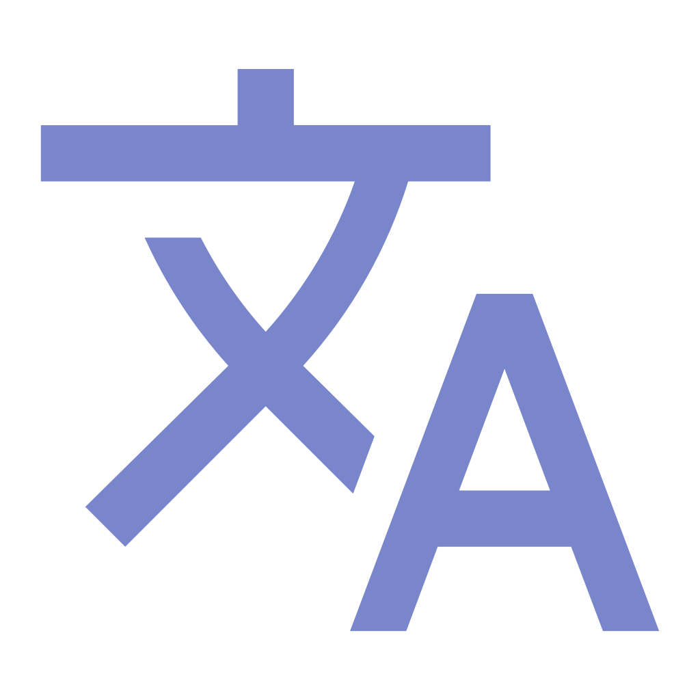
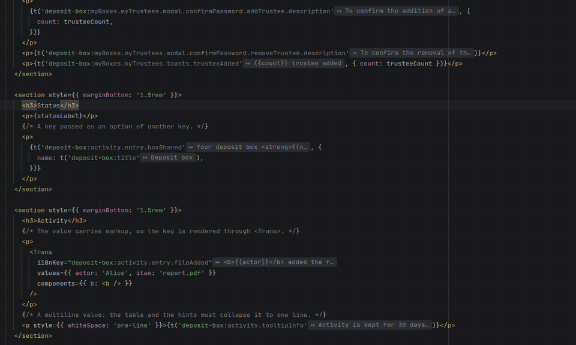
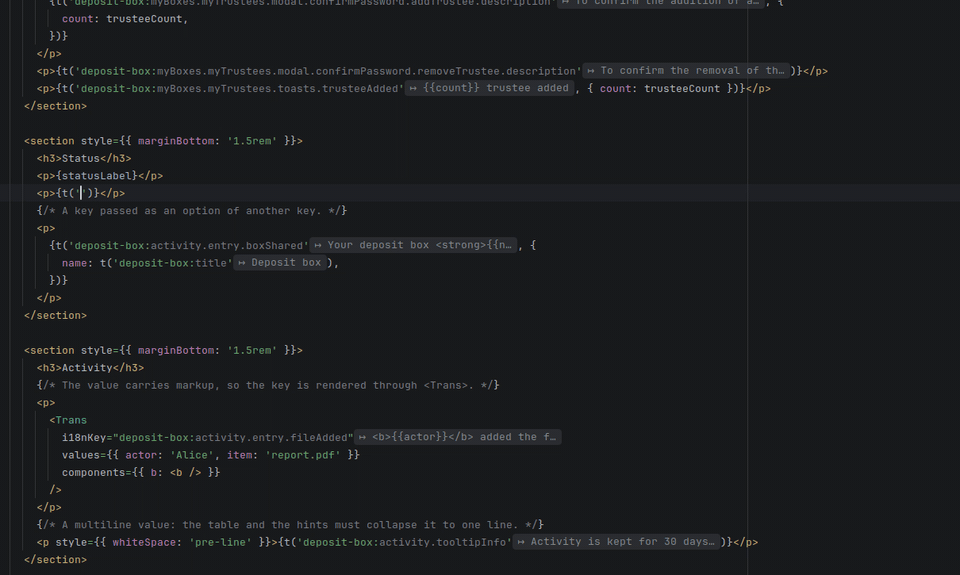
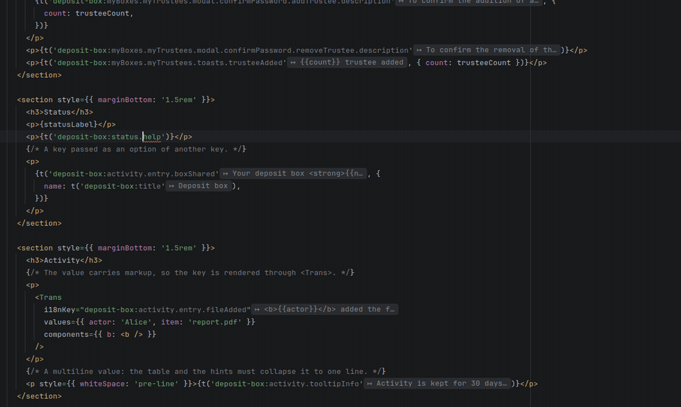
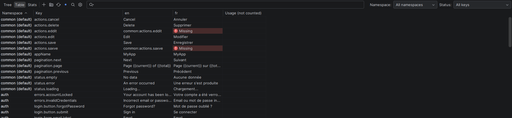
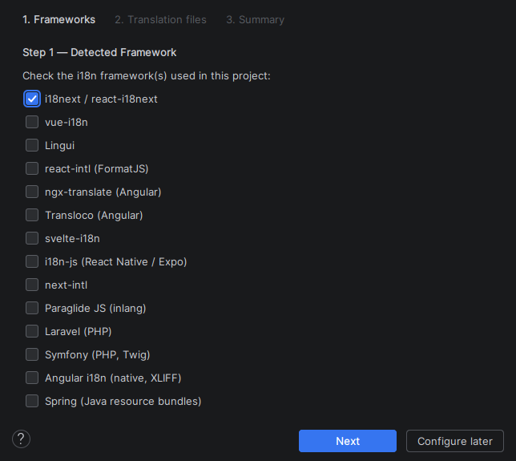

<p align="center">
  <a href="https://plugins.jetbrains.com/plugin/30971-i18n-support-plus">
    <picture>
      <source media="(prefers-color-scheme: dark)" srcset="src/main/resources/META-INF/pluginIcon_dark.svg">
      
    </picture>
  </a>
</p>

<h1 align="center">I18n Support Plus</h1>

<p align="center">
  <b>Your app's translations, handled from the code that uses them.</b><br>
  WebStorm, IntelliJ IDEA Ultimate and PhpStorm 2025.2 and later.
</p>

<p align="center">
  <a href="https://plugins.jetbrains.com/plugin/30971-i18n-support-plus"></a>
  <a href="https://plugins.jetbrains.com/plugin/30971-i18n-support-plus"></a>
  <a href="https://github.com/IBRAHIMDANS/i18nSupportPlus/actions/workflows/ci.yml"></a>
  <a href="LICENSE"></a>
</p>

<p align="center">
  <br>
  <sub>A hard-coded text becomes a key, written in every language at once.</sub>
</p>

<p align="center">
  <a href="https://plugins.jetbrains.com/plugin/30971-i18n-support-plus"></a>
</p>

<p align="center">
  <a href="docs/COMPARISON.md">Compare with i18n Ally and Easy I18n</a>
  ·
  <a href="examples">Examples</a>
  ·
  <a href="CHANGELOG.md">Changelog</a>
  ·
  <a href="https://github.com/IBRAHIMDANS/i18nSupportPlus/issues/new?template=bug_report.md">Report a bug</a>
  ·
  <a href="https://github.com/IBRAHIMDANS/i18nSupportPlus/issues/new?template=feature_request.md">Request a feature</a>
</p>

<!-- Plugin description -->
When an app is translated into several languages, every text in the code becomes a key, such as `t('checkout.pay_now')`, and its wording lives in one file per language. To the IDE that key is a plain string: nothing tells you what it says, whether French still lacks it, or where it is defined.

**I18n Support Plus** makes **WebStorm, IntelliJ IDEA Ultimate and PhpStorm** understand those keys the way they understand a function name:

- **Read** — hover a key to see its text and which languages still lack it; a gutter icon shows its status, and completion offers the keys that really exist
- **Navigate** — Ctrl+click opens the right line of the translation file; Shift+F6 renames the key, or a whole level, in every language and every call site
- **Extract** — select a hard-coded text, press Alt+Enter, and it becomes a key written in every language at once; one Ctrl+Z undoes the files and the code
- **Keep in sync** — a tool window lists what is missing, empty, duplicated or unused, and fills the gaps by machine translation (a local Ollama, DeepL, LibreTranslate, Google or any OpenAI-compatible API) or through Codex, Claude or any MCP client, after a preview and with placeholders and plural forms checked

It also catches what a translation can get wrong: missing plural forms per language, broken placeholders and ICU messages, stale values, hard-coded text. The same checks run in CI with `i18n-check`, as a GitHub Action that annotates the pull request, with the configuration shared in `i18n-check.json`.

Works with **i18next / react-i18next, vue-i18n (Nuxt), next-intl, lingui, react-intl, ngx-translate, Transloco, Angular i18n (`$localize`), svelte-i18n, i18n-js, Paraglide JS, typesafe-i18n, Meteor universe:i18n, Laravel / Blade and Symfony / Twig**, in JS, TS, JSX, TSX, Vue SFC, Svelte, Astro, Angular templates, PHP, Blade and Twig, with **JSON, JSON5, YAML, PO/POT, XLIFF, Laravel PHP arrays, Flutter ARB, Java `.properties`** and plain **TS/JS catalogues**: [every framework, language and format](https://github.com/IBRAHIMDANS/i18nSupportPlus#supported-frameworks). A setup wizard configures it on first launch, monorepo modules included, and rules teach it your own `translate('key')` wrapper.

**Coming from I18n Support?** This plugin is the maintained successor of the original, which no longer installs on IDEs after 2023.1: install it next to the old one, it reads your project settings as they are — see [the migration notes](https://github.com/IBRAHIMDANS/i18nSupportPlus/blob/main/docs/COMPARISON.md#coming-from-i18n-support).

[Documentation](https://github.com/IBRAHIMDANS/i18nSupportPlus#readme) · [Compare with i18n Ally and Easy I18n](https://github.com/IBRAHIMDANS/i18nSupportPlus/blob/main/docs/COMPARISON.md) · [Examples](https://github.com/IBRAHIMDANS/i18nSupportPlus/tree/main/examples) · [Changelog](https://github.com/IBRAHIMDANS/i18nSupportPlus/blob/main/CHANGELOG.md)
<!-- Plugin description end -->

## Contents

- [Installation](#installation) · [Why this plugin?](#why-this-plugin) · [Features](#features) · [Supported Frameworks](#supported-frameworks)
- [Requirements](#requirements) · [Build from Source](#build-from-source) · [Contributing](#contributing)

New to the plugin? [Getting started](docs/getting-started.md) takes you from the installation to your first keys in ten minutes, and defines the words the pages below use.

The reference, one page per topic, in [`docs/`](docs):

- [Frameworks, languages and file formats](docs/frameworks.md): every syntax read, per framework, and the file formats
- [In the editor](docs/editor.md): key status, navigation, completion, extraction, hints, folding, renaming, quick fixes
- [Tool window and bulk actions](docs/tool-window.md): tree and table, reviews, stats, keys synchronizer, export and import
- [Machine translation and AI agents](docs/translation.md): engines, glossary, tone, MCP tools
- [Checks: inspections, CI and the command line](docs/checks.md): inspections, Qodana, `i18n-check`, GitHub Action, Docker
- [Setup and configuration](docs/configuration.md): setup wizard, modules, every setting, `i18n-check.json`

## Installation

In the IDE, **Settings › Plugins › Marketplace**, search for **I18n Support Plus** (plugin ID `com.ibrahimdans.i18n`) and install it, or click *Install* on its [Marketplace page](https://plugins.jetbrains.com/plugin/30971-i18n-support-plus). It installs in any IntelliJ-based IDE 2025.2 or later; the keys in your code need the JavaScript plugin, bundled with WebStorm, IntelliJ IDEA Ultimate and PhpStorm ([Requirements](#requirements)).
On first launch, the setup wizard detects the framework and the translation files and configures the rest.
First steps, from the wizard to your first keys: [Getting started](docs/getting-started.md).

## Why this plugin?

On a real i18next/vue-i18n project, your keys and translations live in files
your editor treats as dead text — so you keep opening JSON files just to check
whether a key exists, in which namespace, and whether it's translated everywhere.

**I18n Support Plus turns i18n keys into first-class code symbols.**

- **See & navigate** — inline resolution status (gutter ✅/⚠️/❌), Ctrl+Click to the
  translation and back, value hints (inlay + folding + hover), autocomplete from your
  real keys (namespaces included), dynamic/wildcard keys supported.
- **Edit safely** — extract hard-coded strings (`Alt+Enter`), rename across all
  locales and code (`Shift+F6`), move a key to another namespace (`Ctrl+Alt+Shift+M`),
  sort keys in the order you choose.
- **Stay healthy** — tool window with tree/table views grouped by namespace, coverage
  stats per namespace and locale, Keys Synchronizer (propagate missing keys in bulk),
  Count Key Usages (find keys no code refers to), CSV and XLIFF export/import, and inspections for missing,
  empty, duplicate or inconsistent values.

Every library, language and file format it reads: [Supported Frameworks](#supported-frameworks).

**Coming from i18n Ally or Easy I18n?** See the [feature-by-feature comparison](docs/COMPARISON.md) and how to carry your settings over.

## Features

### See every key where you use it

A gutter icon tells whether a key exists in all, some or no locale. Its value shows as an inline hint, in a Ctrl+hover table of every locale, or folded in place of the key. Ctrl+click opens the translation, and completion offers the keys that really exist, namespaces included.



Details: [In the editor](docs/editor.md).

### Extract, rename and move keys safely

`Alt+Enter` turns a hard-coded string into a key, written in every locale; *Internationalize…* does a whole file or folder after a preview. `Shift+F6` renames a key, or a whole level, in every locale and call site, and `Ctrl+Alt+Shift+M` moves a key to another namespace. One Ctrl+Z undoes the files and the code.



Details: [Key Extraction](docs/editor.md#key-extraction), [Rename Refactoring](docs/editor.md#rename-refactoring), [Actions on keys](docs/editor.md#actions-on-keys).

### Every key of every locale in one table

The tool window shows the keys as a tree or an editable table, filters the missing, empty, duplicate and unreferenced ones, and gives the coverage of each namespace and locale. It also holds the keys synchronizer, the reviews, CSV and XLIFF export and import, and the comparison with a Git branch.



Details: [Tool window and bulk actions](docs/tool-window.md).

### Translate the missing values, or let an AI agent do it

Machine translation is opt-in, through a local Ollama, DeepL, LibreTranslate, Google or any OpenAI-compatible API. Placeholders, tags and the target language's plural forms are kept, and nothing is written before a preview. Codex, Claude or any MCP client can do the same through the plugin's tools on the IDE's MCP server.

Details: [Machine translation and AI agents](docs/translation.md).

### Catch the problems in the IDE and in CI

Twenty-five inspections check the translations and the code: unknown keys in the code, missing, orphan, empty and duplicate keys, placeholders, markup, ICU messages, plural forms, stale translations and hard-coded text. `i18n-check` runs the same checks in CI, as a GitHub Action or from the command line, and annotates the pull request; a Docker image is published on request.

Details: [Checks: inspections, CI and the command line](docs/checks.md).

### Set up in one step

On first launch, the setup wizard detects the framework and the translation files, and creates a module per application in a monorepo. The settings can be shared with the team in `i18n-check.json`.



Details: [Setup and configuration](docs/configuration.md).

## Supported Frameworks

| Framework | For example |
|-----------|-------------|
| i18next / react-i18next | `t('ns:key')`, `useTranslation('ns')`, `<Trans i18nKey="key">` |
| vue-i18n (Nuxt) | `$t('key')`, `<i18n-t keypath="key">`, `v-t="'key'"` |
| next-intl | `const t = useTranslations('Home')`, then `t('title')` |
| Lingui | `i18n._('key')`, `msg('key')`, `<Trans>Hello world!</Trans>` |
| react-intl (FormatJS) | `formatMessage({ id: 'key' })`, `<FormattedMessage id="key" />` |
| ngx-translate | `translate.instant('key')`, `{{ 'key' \| translate }}` |
| Transloco | `translocoService.translate('key')`, `{{ 'key' \| transloco }}` |
| Angular i18n | `<h1 i18n="@@home.title">`, `` $localize`:@@home.title:Welcome` `` |
| svelte-i18n | `$_('key')` |
| i18n-js | `i18n.t('key')` |
| Paraglide JS | `m.hello()` |
| typesafe-i18n | `LL.home.title()` |
| Meteor universe:i18n | `const t = useTranslator('Home')`, then `t('title')` |
| Laravel / Blade | `__('key')`, `trans_choice('key', 2)`, `@lang('key')` |
| Symfony / Twig | `$translator->trans('key', [], 'admin')`, `{{ 'key'\|trans }}`, `key` |

The keys are read in JS, TS, JSX, TSX, Vue SFC, Svelte, Astro, Angular templates, PHP, Blade and Twig, and the translations in JSON, JSON5, YAML, PO/POT, XLIFF, Laravel PHP arrays, Symfony catalogues, Flutter ARB, Java `.properties` and TS/JS catalogues. Every syntax, language and format: [Frameworks, languages and file formats](docs/frameworks.md).

## Requirements

- Any IntelliJ-based IDE 2025.2+ (build 252–263.*), verified against 2025.2, 2025.3, 2026.1, 2026.2 and 2026.3
- Without the JavaScript plugin (IntelliJ IDEA Community, Android Studio, PyCharm, an unlicensed IntelliJ IDEA 2025.3+): the tool window, the inspections of the translation files, machine translation and the AI agent tools; no key in the code
- On 2025.1, the last compatible version is 1.11.1
- Java 21+ only for `i18n-check` on the command line and for building the plugin: in the IDE, the plugin runs on the IDE's own runtime
- No usage statistics; what is sent, to whom and when: [What leaves your machine](docs/translation.md#what-leaves-your-machine)

### Plugin Dependencies

| Plugin | Required | Enables |
|--------|:--------:|---------|
| JavaScript | No | Keys in JS, TS, JSX and TSX code: highlighting, completion, navigation, extraction, the frameworks' calls, TypeScript translation files (WebStorm, IntelliJ IDEA Ultimate, PhpStorm) |
| Vue.js | No | vue-i18n support (`$t`, `$tc`, `$te`, `<i18n-t keypath>`, `v-t`) |
| YAML | No | `.yaml`/`.yml` translation files |
| PHP | No | PHP language support |
| Localization | No | PO/POT gettext files |
| Angular | No | Translation pipes and Transloco directives in Angular templates (`.html`) |
| Blade | No | Keys in Blade views (`{{ __('key') }}`, `@lang`) |
| Twig | No | Keys in Twig templates of a Symfony project (`{{ 'key'\|trans }}`, ``) |
| Svelte | No | Keys in `.svelte` components |
| Astro | No | Keys in `.astro` components |
| Git | No | *Compare with Branch* (translation changes of a branch) |
| MCP Server | No | The tools AI agents call (2025.2.6+) |

## Build from Source

```bash
git clone https://github.com/IBRAHIMDANS/i18nSupportPlus.git
cd i18nSupportPlus
./gradlew buildPlugin
# Output: "build/distributions/i18n Support Plus-<version>.zip"
```

Then install via **Settings > Plugins > ⚙️ > Install Plugin from Disk**.

## Contributing

See [CONTRIBUTING.md](CONTRIBUTING.md) for contributor setup, run/test commands, architecture notes, conventions, and troubleshooting tips.

## Credits

Originally created by [Evgeniy Nyavro](https://github.com/nyavro/i18nPlugin).

Maintained by [Ibrahim Dansoko](https://github.com/IBRAHIMDANS). Licensed under [MIT](LICENSE).
