# I18n Support Plus

Plugin ID: `com.ibrahimdans.i18n`

<!-- Plugin description -->
Turns i18n keys into first-class code symbols in **WebStorm, IntelliJ IDEA Ultimate and PhpStorm**: see each key's value and status, jump to it, rename it, translate it and keep every locale in sync.

Maintained successor of **I18n Support**, which no longer installs on IDEs after 2023.1: a fork of it, installed separately rather than as an update, that reads its project settings back as they are — see [Coming from I18n Support?](https://github.com/IBRAHIMDANS/i18nSupportPlus/blob/main/docs/COMPARISON.md#coming-from-i18n-support).

Works with **i18next / react-i18next, vue-i18n (Nuxt), next-intl, lingui, react-intl, ngx-translate, Transloco, svelte-i18n, i18n-js, Paraglide JS and Laravel / Blade**, in JS, TS, JSX, TSX, Vue SFC, Angular templates and PHP, with **JSON, JSON5, YAML, PO/POT** and plain **TS/JS catalogues**. A setup wizard configures it on first launch, monorepo modules included.

- **See** — gutter status per key (all / some / no locale), inline value hints, folding and hover in a preview locale, completion of real keys, namespaces included
- **Edit safely** — extract hardcoded strings (variables and plural forms included), rename a key or a whole level across every locale and call site (`Shift+F6`), move a key to another namespace; one Ctrl+Z undoes the files and the code
- **Translate** — opt-in machine translation of empty locales, for one key or a whole locale, through a local Ollama (nothing leaves the machine), DeepL, LibreTranslate, Google or any OpenAI-compatible API; variables, tags and the target language's plural forms are kept, and nothing is written before a preview
- **AI agents** — Codex, Claude or any MCP client translates through the plugin's tools on the IDE's MCP server, on your own AI plan: only missing values are written, placeholders and plural forms are checked, and one Ctrl+Z undoes it (2025.2.6+)
- **Plurals done right** — i18next `_one` / `_other` keys and nested plural objects resolve, missing CLDR forms per language are reported, ICU messages are validated
- **Stay healthy** — tool window with tree and table views, filters for missing, empty, duplicate and unreferenced keys, coverage per namespace and locale, a keep list for keys used outside the code, keys synchronizer, cleanup, CSV and XLIFF export / import, comparison with a Git branch
- **Your own calls** — rules turn `translate('key')` or `__('key')` into translation calls, and a module can write its own wrapper's call at extraction
<!-- Plugin description end -->

## Why this plugin?

On a real i18next/vue-i18n project, your keys and translations live in files
your editor treats as dead text — so you keep opening JSON files just to check
whether a key exists, in which namespace, and whether it's translated everywhere.

**I18n Support Plus turns i18n keys into first-class code symbols.**

- **See & navigate** — inline resolution status (gutter ✅/⚠️/❌), Ctrl+Click to the
  translation and back, value hints (inlay + folding + hover), autocomplete from your
  real keys (namespaces included), dynamic/wildcard keys supported.
- **Edit safely** — extract hardcoded strings (`Alt+Enter`), rename across all
  locales and code (`Shift+F6`), move a key to another namespace (`Ctrl+Alt+Shift+M`),
  sort keys alphabetically.
- **Stay healthy** — tool window with tree/table views grouped by namespace, coverage
  stats per namespace and locale, Keys Synchronizer (propagate missing keys in bulk),
  Scan Orphans (find keys no code refers to), CSV export/import, and inspections for empty,
  duplicate or inconsistent values.

Works with **i18next / react-i18next, vue-i18n, next-intl, lingui, react-intl, ngx-translate, Transloco, svelte-i18n,
i18n-js, Paraglide JS, Meteor universe:i18n and Laravel / Blade**, across JS/TS/JSX/TSX, Vue SFC, Svelte, Astro,
Angular templates, PHP and Blade, with JSON, JSON5, YAML, PO/POT, Laravel PHP arrays and TS/JS catalogues.
A setup wizard auto-configures it on first launch, a module per application in a monorepo.

**Coming from i18n Ally or Easy I18n?** See the [feature-by-feature comparison](docs/COMPARISON.md) and how to carry your settings over.

## Supported Frameworks

| Framework | Recognised syntaxes | Config-based |
|-----------|--------------------|:------------:|
| i18next / react-i18next | `t('ns:key')`, `` t(`key.${suffix}`) ``, `t('key', { ns: 'other' })`, `useTranslation('ns')`, `<Trans i18nKey="key">` | Yes |
| vue-i18n (Nuxt: `@nuxtjs/i18n`) | `$t('key')`, `$tc('key')`, `$te('key')`, `<i18n-t keypath="key">`, `v-t="'key'"` | No |
| next-intl | `const t = useTranslations('Home')` (or `await getTranslations('Home')`) then `t('title')`, read as the key `Home.title`; `t.rich('terms', { … })`, `t.markup`, `t.raw` (an object or an array is a value) and `t.has` (a usage, never reported missing) | No |
| lingui (`@lingui/core`, `@lingui/react`, `@lingui/macro`) | `msg('key')`, `i18n._('key')`, source-based `<Trans>Hello world!</Trans>` | No |
| react-intl (FormatJS) | `formatMessage({ id: 'key' })`, `<FormattedMessage id="key" />` | No |
| ngx-translate (Angular) | `translate.instant('key')`, `.get('key')`, `.stream('key')`, `{{ 'key' \| translate }}` <sup>1</sup> | No |
| Transloco (Angular) | `translocoService.translate('key')`, `.selectTranslate('key')`, `{{ 'key' \| transloco }}` <sup>1</sup>, `*transloco="let t"` then `t('key')` <sup>4</sup> | No |
| svelte-i18n | `$_('key')`, `_('key')` <sup>2</sup> | No |
| i18n-js (React Native / Expo) | `t('key')`, `i18n.t('key')`, plain locale-keyed TS/JS catalogues, nested plurals <sup>3</sup> | No |
| Paraglide JS (inlang) | `m.hello()`, `m["user.profile.title"]()`, once the file imports `m` from `…/paraglide/messages.js` <sup>5</sup> | Yes, `project.inlang/settings.json` |
| Meteor universe:i18n | the application's own hook, `useTranslator('Home')` or `useTranslation('Home')`, then `t('title')`, read as the key `Home.title` <sup>6</sup> | No |

`useTranslation` supports both string form (`useTranslation('ns')`) and array form (`useTranslation(['ns1', 'ns2'])`). The namespace can also come from an options object (`t('key', { ns: 'auth' })`) or from the key itself (`t('auth:key')`).

<sup>1</sup> The `| translate` and `| transloco` pipes are recognised in JSX/TSX and in standalone Angular templates (`.html`). A template is parsed as Angular only inside an Angular project — a component referencing it through `templateUrl`, with `@angular/core` resolvable; outside one the file stays plain HTML and the pipe is inert text.

<sup>2</sup> `.svelte` single-file components are analysed as well, provided the [Svelte plugin](https://plugins.jetbrains.com/plugin/12375-svelte) is installed — it is not bundled with IntelliJ Ultimate, and without it a `.svelte` file is plain text to the IDE. With it, both the `<script>` block and `{…}` expressions in the markup are ordinary JavaScript, so keys inside them resolve like any other.

<sup>3</sup> i18n-js pluralizes into a nested object (`{ one: …, other: … }`) rather than through i18next's flat `key_one` suffixes; such a key is treated as resolved. Its `%{count}` placeholders are displayed verbatim, as the plugin interprets no interpolation syntax.

<sup>4</sup> Transloco's service calls are recognised when the object they are called on names the service (`translocoService`, `transloco`): `translate` alone is too common a method name. Scoped keys resolve in their scope file: `admin.title` reads the key `title` of `i18n/admin/en.json`, a folder named after its scope next to the global locale files. The first segment is read as a scope only when such a folder exists, and only in a Transloco project. A scope set by the directive (`*transloco="let t; read: 'admin'"`, then `t('title')`) is read; the `[translocoRead]` input is not.

<sup>5</sup> Paraglide compiles each message into a function, so the key is the
member of the message object, not a string. It is read in a file importing that object from a path ending in `paraglide/messages` — `{ m }`,
`{ m as msg }`, or Paraglide 1's `import * as m` — in `.js`, `.ts`, Svelte components (with the Svelte plugin) and Astro components (with the Astro plugin).
Annotation, completion after `m.` (with the messages not yet compiled), folding, hover and inlay hints, Ctrl+click to
the message rather than the generated function, and from a message file to its call sites, usages, Shift+F6 (in every message file and call site, `m["a.b"]` when the new
name is no identifier) and *Extract I18n* (which writes `m.key({ name })` and adds the import) all work on it. The message files are read where `project.inlang/settings.json` puts them, one inlang
project per folder in a monorepo, and the generated folder is never counted as a use. Limits: a message with variants
(a `match` array) is displayed as its catch-all branch and edited as raw JSON; `m[variable]` names no key; in Svelte components
only annotation, folding and usages are tested, in Astro components annotation, completion and the navigation from a
message file, in the frontmatter and in template expressions. A ready-to-open project:
[examples/paraglide-js](examples/paraglide-js/README.md).

<sup>6</sup> universe:i18n ships no React hook since its v2: its documentation has the application write one, and the plugin reads the argument of `useTranslator` — or of `useTranslation`, unless the file imports it from an i18next package — as a key prefix once `.meteor/packages` declares `universe:i18n`. `i18n.__()`, `getTranslation()` and `*.i18n.json` files are not read yet.

## Supported Languages

| Language | Extensions | Annotations | Completion | Folding | Hints | References |
|----------|-----------|:-----------:|:----------:|:-------:|:-----:|:----------:|
| JavaScript | `.js` | ✓ | ✓ | ✓ | ✓ | ✓ |
| TypeScript | `.ts` | ✓ | ✓ | ✓ | ✓ | ✓ |
| JSX | `.jsx` | ✓ | ✓ | ✓ | ✓ | ✓ |
| TSX | `.tsx` | ✓ | ✓ | ✓ | ✓ | ✓ |
| Vue SFC | `.vue` | ✓ | ✓ | ✓ | ✓ | ✓ |
| PHP | `.php` | ✓ | ✓ | ✓ | ✓ | ✓ |
| Blade | `.blade.php` | ✓ | — | — | — | ✓ |
| Angular templates | `.html` | ✓ | — | — | — | ✓ |
| Svelte | `.svelte` | ✓ | — | ✓ | — | — |
| Astro | `.astro` | ✓ | ✓ | ✓ | — | ✓ |

**—** means no test covers it yet: it may work, it is not promised. A ✓ is backed by a test.

> Vue support requires the Vue.js plugin (optional dependency).
> PHP support requires the PHP plugin (optional dependency); Blade views, the Blade plugin, bundled in PhpStorm.
> Angular templates require the Angular plugin, and are read inside an Angular project only (see <sup>1</sup> above).
> Svelte components require the [Svelte plugin](https://plugins.jetbrains.com/plugin/12375-svelte) (see <sup>2</sup> above).
>
> Astro components (`.astro`, with astro-i18next or i18next) are analysed provided the [Astro plugin](https://plugins.jetbrains.com/plugin/20959-astro) is installed — it is not bundled with IntelliJ Ultimate, and without it a `.astro` file is plain text to the IDE. With it, `t('key')` in the `---` frontmatter and in `{…}` template expressions is ordinary JavaScript: annotations, completion, folding and references work as in a `.ts` file.
>
> In a Laravel project — a `composer.json` outside `vendor/` requiring `laravel/framework` or `illuminate/translation` — `__()`, `trans()` and `trans_choice()` are translation calls too, and extracting a string writes `__('…')`. Elsewhere `__()` is left alone: WordPress passes it a text, not a key. In Blade views (with the Blade plugin, bundled in PhpStorm), keys inside `{{ … }}` and `{!! … !!}` echoes are read like any PHP key, and so are those of the `@lang('key')` and `@choice('key', n)` directives. Laravel's translator called in PHP — `app('translator')->get('key')`, `->choice('key', n)`, the `Lang` facade — is recognised as well.

## Translation File Formats

| Format | Extensions | References | Content generation |
|--------|-----------|:----------:|:------------------:|
| JSON | `.json`, `.json5` | ✓ | ✓ |
| YAML | `.yaml`, `.yml` | ✓ | ✓ |
| PO/POT (gettext) | `.po`, `.pot` | ✓ | ✓ |
| Laravel PHP arrays | `lang/<locale>/<file>.php`, the file name as namespace | ✓ | ✓ |
| TS/JS catalogues (an object keyed by locale, as i18n-js writes) | `.ts`, `.js` | — | — |
| i18next `resources` declared in a TS/JS configuration file | `.ts`, `.js` | — | — |

**—** means no test covers it yet. Keys of the last two formats are read and annotated; whether Ctrl+click reaches
their value and whether a missing key is written into them is not tested. XLIFF, like CSV, is exported and imported
from the tool window, not read as a translation source.

Keys are resolved as nested properties by default (`app.header.title` walks three levels).
Projects storing **flat ids** — one property per key, as react-intl / FormatJS usually do —
should enable **Treat keys as flat** in *Settings → Tools → i18n Support Plus Configuration*.
The setting turns off key-separator splitting and namespace parsing altogether, so the whole
id is looked up as a single property and translation files are located through the default
namespace.

## Features

### Setup Wizard

On first launch, a wizard guides you through configuration in 3 steps:

1. **Framework detection** — auto-detects i18next, vue-i18n, lingui, react-intl, ngx-translate, Transloco, svelte-i18n, i18n-js or Paraglide JS from your `package.json`
2. **Translation file discovery** — scans for `.json`, `.yaml`, `.po`, and `.pot` files in `locales/`, `i18n/`, `translations/` folders (PO/POT support requires the optional **GNU GetText** plugin — see Plugin Dependencies)
3. **Summary** — review and apply the configuration. In a monorepo, where the catalogues sit in several applications (`apps/shop/public/locales`, `apps/admin/public/locales`), it proposes one module per application, ticked by default: each is rooted at the application's folder (the one holding its `package.json` or `composer.json`, else the folder above `public/`, `src/`, `locales/`…), named after it, and given the framework its own manifest declares. Untick a module to put it aside (see *Modules*)

You can reopen it at any time from **Tools > i18n Support Plus > Run Setup Wizard**.

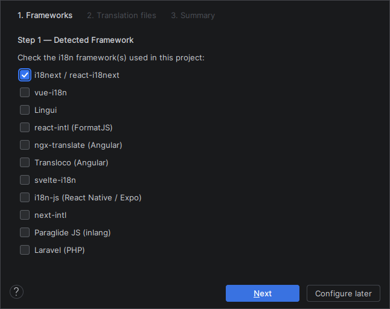
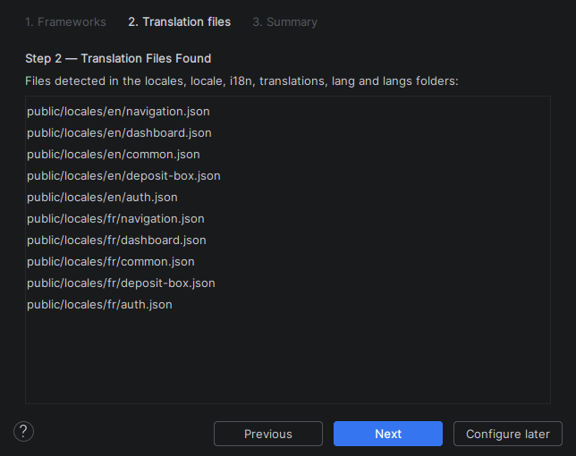
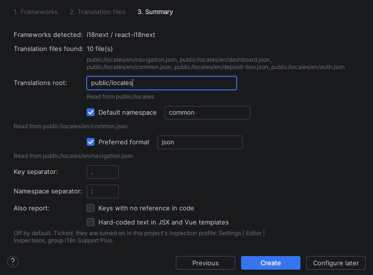

### Annotations

Highlights i18n keys with visual feedback on resolution status:

| Status | Description |
|--------|-------------|
| Resolved key | Key found in all translation files |
| Unresolved segment | Part of the key path doesn't exist |
| Missing file | Referenced namespace file not found |
| Object reference | Key points to a JSON object instead of a value |
| Plural reference | Key resolves to plural variants (`_one`, `_other`, etc.) |
| Partial translation | Key exists in some locales but not all (opt-in) |

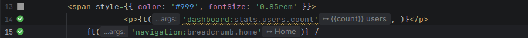
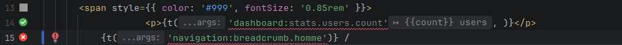
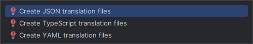

### Navigation

**Ctrl+Click** on any i18n key navigates directly to the translation value in the JSON/YAML file.

- Opens the **preview locale** (the folding language when none is set) rather than asking which file; when that locale lacks the key, every target is offered
- Works with partially resolved keys (navigates to the deepest resolved node)
- Bidirectional: navigate from translation files back to code usage

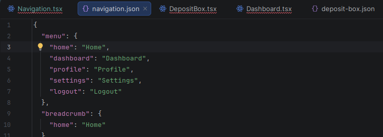

### Code Completion

Autocomplete i18n keys as you type, with full namespace support. Suggestions are drawn from all translation files in the project.

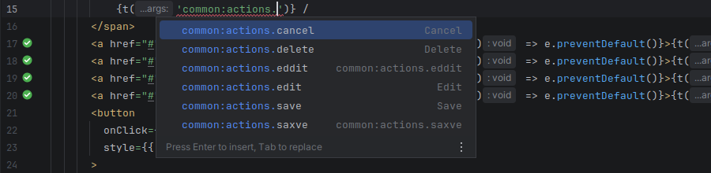

### Key Extraction

Extract hardcoded strings into translation files via **Alt+Enter** intention action. Supports sorted insertion (`Extract sorted` setting).

In a react-intl project — a module on the `react-intl` preset, or, without modules, a file importing `react-intl` — a JSX text becomes `<FormattedMessage id="key" />` (variables in `values`), and an attribute or a string `intl.formatMessage({ id: 'key' })`, with the name the component gives `useIntl()`. `FormattedMessage` is imported from `react-intl`, merged into the file's import when it has one. Without a `useIntl()` in scope, a string is not extracted — the hint asks for one, and *Batch Extract* lists it unchecked with that reason — while *Internationalize…* gives the component `const intl = useIntl()` and its import. *Write the default value in the call* adds `defaultMessage`; a module's call template still wins.

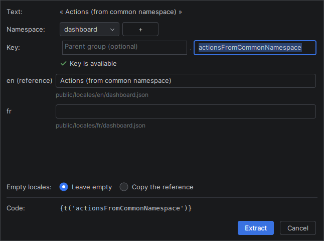
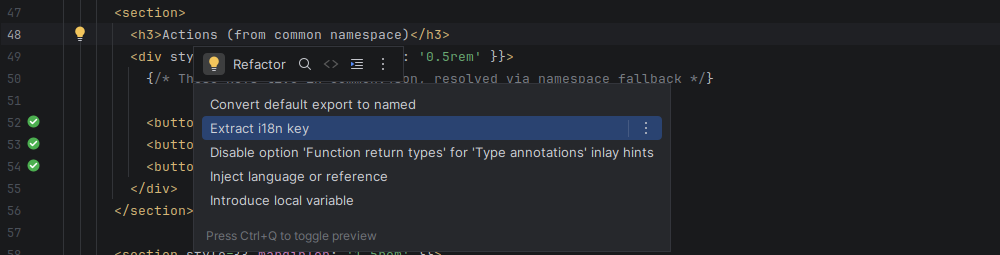
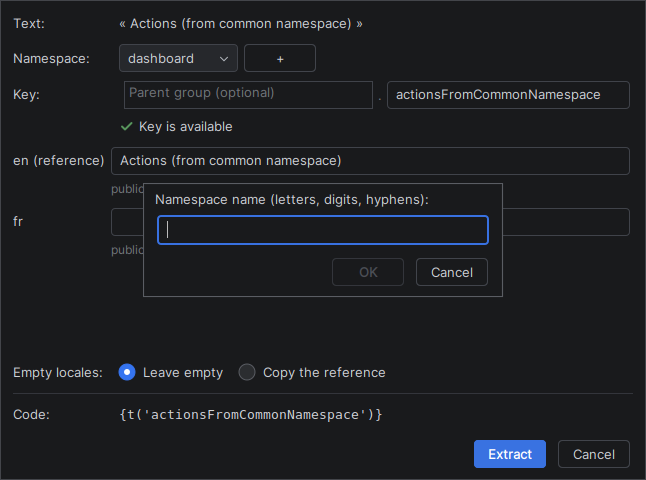
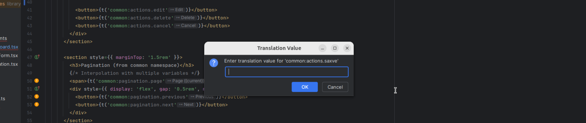

### Gutter Badges

Line markers in the editor gutter indicate key resolution status at a glance:

| Icon | Meaning |
|------|---------|
| ✅ Green | Key resolved in **all** locales |
| ⚠️ Yellow | Key resolved in **some** locales (partial) |
| ❌ Red | Key not found in **any** locale |

Hovering a badge lists the locales; clicking a partial/missing badge triggers the quick fix to create the missing key.

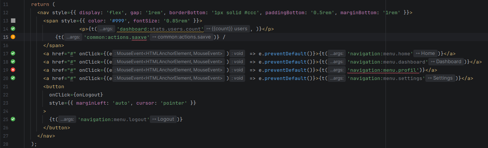
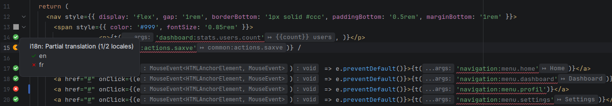

### Inlay Hints

Displays the resolved translation value inline after each i18n key expression, directly in the editor. Toggle via **Editor > Inlay Hints > i18n translations**.

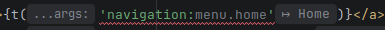

### Hover Hints

**Ctrl+hover** on an i18n key shows a tooltip with all translations grouped by locale, with missing translations shown as "—" and a navigation link (↗) to the translation file.

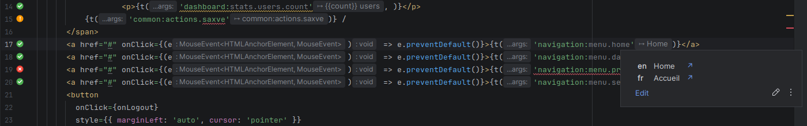

### Preview Locale

`i18n: en` in the status bar says which locale inlay hints, hover, Ctrl+click and folding read in. Click it to pick another of the project's locales; **Switch Preview Locale** in the editor's context menu cycles through them, ready for a shortcut. The *Preview locale* and *Preferred folding language* settings stay for anyone who wants the two apart.

### Code Folding

Replaces i18n keys with their translation values inline for better readability. Toggle with **Ctrl+Alt+Shift+T** or via the editor context menu.

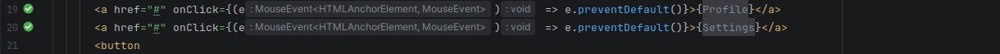


### Rename Refactoring

Rename i18n keys across all translation files and source code references with **Shift+F6** — every call site, whether written with its namespace, under a hook namespace or under a key prefix; plural suffixes (`_one`, `_other`) are kept.

With the caret on an intermediate level of a key (`button` in `common:button.save`), or on a property holding other keys in a translation file, **Shift+F6** renames the whole level: `button.*` becomes `actions.*` in every locale and at every call site, a hook's `keyPrefix` included. A level that already exists is refused rather than merged, and keys built at runtime (`` t(`button.${action}`) ``) are listed in the confirmation, not rewritten.

### Bulk Actions

| Action | Where | What it does |
|--------|-------|--------------|
| Batch Extract i18n Keys | **Code** menu, `Ctrl+Alt+Shift+B` | Extract several hardcoded strings of a file as keys in one pass |
| Move i18n Key to Namespace… | editor context menu, `Ctrl+Alt+Shift+M` | Move a key to another namespace, updating every locale file and code reference |
| Sort i18n Keys Alphabetically | editor context menu, in a translation file | Reorder the file's keys, recursively |
| Sync Keys | **Tools > i18n Support Plus**, tool window toolbar | Create in every locale the keys it lacks, with a batch dialog to fill the values |
| Export Translations to CSV… | **Tools > i18n Support Plus** | One row per key, one column per locale |
| Import Translations from CSV… | **Tools > i18n Support Plus** | Write values back from a CSV, with a preview of what changes before anything is written |
| Show Translation Changes | **Tools > i18n Support Plus**, Commit tool window | The keys the working copy adds, removes or changes, per locale, and the locales left behind |
| Compare Translations with Branch… | **Tools > i18n Support Plus**, Commit tool window | The same against a branch (`origin/main` by default), committed changes included: the translations of a pull request. Needs the Git plugin |
| Cleanup Unused Keys… | **Tools > i18n Support Plus** | Find the keys no code refers to and delete the selected ones from every locale. A key used outside the code (API, config, database) cannot be detected: keep it in *Keys used outside the code* |

### Inspections

Enabled under **Settings > Editor > Inspections > i18n Support Plus**:

| Inspection | Reports |
|------------|---------|
| Empty translation value | A key whose value is blank in a translation file |
| Duplicate translation value | Two keys of a file holding the same value |
| Placeholder consistency across locales | A `{name}` or `%s` placeholder present in one locale and not in another, or an unbalanced brace |
| ICU message format validation | Unbalanced braces, a `plural` block without `one`/`other`, … |
| Unused translation key | A key of a translation file no code refers to, unless the settings keep it (*Keys used outside the code*); quick fixes: delete it, or keep it |
| Translation key absent from the reference locale | A key of a locale that the reference locale's file does not hold — renamed in the reference only, or mistyped — plural forms compared as a group (off by default); quick fixes: remove it from the locale, or add it empty to the reference |
| Translation reviewed on a source that changed since | Where a module keeps reviews, a value still the one reviewed while the key's reference text changed since (weak warning) |
| Key naming convention | A key not following the project's convention — camelCase, snake_case, kebab-case or a pattern of your own — segment by segment, plural suffixes aside (off by default); quick fix: rename it in every locale and call site |

### Continuous Integration

The inspections also run without an editor, in [Qodana](https://www.jetbrains.com/qodana/) or a headless IDE: a pull request adding a key without its translation, or dropping one from a locale, fails the build. Ready-to-copy `qodana.yaml`, GitHub workflow and inspection profile: [docs/ci](docs/ci/README.md).

### Command Line Check

`i18n-check` compares the translation files of a project to the reference locale, without IntelliJ. It needs Java 21 and is not shipped with the plugin: each [GitHub release](https://github.com/IBRAHIMDANS/i18nSupportPlus/releases), from 1.16.0, carries it as `i18n-check-<version>.zip`.

```bash
unzip i18n-check-1.16.0.zip
i18n-check-1.16.0/bin/i18n-check [project] [--locales <dir> | --code] [--reference <locale>] [--format text|json] [--max-problems N]
```

`./gradlew :cli:installDist` builds it from this repository instead, in `cli/build/install/i18n-check/`.

It runs the plugin's own checks in CI, with the plugin's settings, whatever the framework. An i18next project that also wants to write the keys the code uses into its files, sync its locales or generate types can pair it with the official [i18next-cli](https://github.com/i18next/i18next-cli) (`extract`, `sync`, `types`).

- `project` (the current directory by default) is searched for translation files as the plugin finds them: a folder or file named after a locale (`locales/en/common.json`, `i18n/fr.yml`), keys of a namespace file reported as `common:key`. `node_modules`, `build`, `dist` and the like are never searched.
- Translation files are read in JSON (`.json`, strict), JSON5 (`.json5`: comments, unquoted keys, single quotes, trailing commas), YAML (`.yml`, `.yaml`) and as TypeScript / JavaScript catalogues (`.ts`, `.js`). A `.json5` file takes the JSON settings, as in the plugin.
- A catalogue is the object literal the file exports: `export default { … }` (or the `const` it names), `module.exports = { … }`, or the only `export const messages = { … }`, with `as const` or `satisfies …` allowed. Keys and values must be literals: a spread (`...common`), a computed key, an imported or built value (`` `Hi ${name}` ``, `t('x')`) stop the check with exit `2`, naming the file and the line, since the keys it hides would be reported missing. A `.ts` or `.js` file exporting no object, a helper beside the catalogues, is left out.
- A folder or file named with a country code beside real locales (`locales/gb/` next to `locales/en/`) is not a locale: the check leaves it out and says so on the error output, naming the path. `"localeAliases": "gb=en-GB"` makes it one, checked with `en-GB`'s plural forms.
- `.idea/i18nSettings.xml`, when the project has one, applies: the translations root, the excluded folders, the default namespaces, the ignored locales (left out of the report), the reference locale (the module's, then the preview locale, then `en`), the key and namespace separators, and the modules — with several, each is checked on its own, with its own reference locale. `--reference` overrides it; `en` also finds `en-US`.
- `i18n-check.json`, at the project's root, takes the place of `.idea/i18nSettings.xml` for a project that keeps `.idea/` out of version control; when both exist, it wins and the XML is not read. It takes the names of the IDE's settings, and fails the check (exit `2`) on a name it does not know:

  ```json
  {
    "translationsRoot": "src/locales",
    "keySeparator": ".",
    "ignoredLocales": "xx",
    "modules": [{ "name": "web", "rootDirectory": "apps/web", "pathTemplate": "public/locales/{lang}/{ns}.json", "referenceLocale": "fr" }]
  }
  ```

  Settings: `translationsRoot`, `excludedDirectories`, `defaultNs`, `fallbackNs`, `ignoredLocales`, `previewLocale`, `foldingPreferredLanguage`, `nsSeparator`, `keySeparator`, `flatKeys`, `gettext`, `localeAliases`; per module: `name`, `rootDirectory`, `pathTemplate`, `fileTemplate`, `referenceLocale`, `enabled` (`false` puts the module aside: neither checked nor reported).
- `--locales <dir>` checks only that directory: a file per locale (`en.json`, `fr.yml`) or a folder per locale with a file per namespace (`en/common.json`); other files are left alone.
- For each locale, it reports the keys **missing** compared to the reference, the **orphan** keys the reference does not hold, and the **empty** values. Plural keys (`item_one`, `item_other`) are checked against the forms each language needs: `ja` only `item_other`, `ru` also `item_few` and `item_many`.
- `--code`, for i18next and react-i18next projects, also reads the JavaScript and TypeScript files (`t('key')`, `useTranslation`, `<Trans i18nKey>`) and reports the **unused** keys of the reference locale — a key a template literal may build, such as `` t(`status.${kind}`) `` for `status.*`, is not one — and the **unknown** keys, called by the code but absent from the reference locale, with their file and line.
- Exit code: `0` when the problems, unused and unknown keys included, do not exceed `--max-problems` (0 by default), `1` when they do, `2` on a wrong command line, a file that does not parse, an unknown reference locale or no translation file.

`--format json` prints (`unused` and `unknown` with `--code` only):

```json
{
  "reference": "en",
  "problems": 5,
  "locales": [
    { "locale": "en", "missing": [], "orphans": [], "empty": [] },
    { "locale": "fr", "missing": ["common:actions.edit"], "orphans": ["common:actions.old"], "empty": ["navigation:menu.home"] }
  ],
  "unused": ["common:status.loading"],
  "unknown": [{ "key": "dashboard:stats.user", "file": "src/components/Dashboard.tsx", "line": 27 }]
}
```

A project of several modules lists them under `modules`, each with its `module` name, `reference`, `problems`, `locales` and `unused`; `problems` and `unknown` stay at the top.

A GitHub Actions job failing the build on a missing translation or a key the code calls but no file holds. The action sets up Java 21 and runs the `i18n-check` of the release its tag names:

```yaml
jobs:
  translations:
    runs-on: ubuntu-latest
    steps:
      - uses: actions/checkout@v4
      - uses: IBRAHIMDANS/i18nSupportPlus@v1.16.0
        with:
          args: --code
```

`args` takes the command line's arguments, `version` another release than the tag's.

### AI Agents (MCP)

On IntelliJ-based IDEs 2025.2.6 and later, the plugin adds four tools to the IDE's built-in MCP server, so an AI agent translates through the plugin rather than by rewriting the files — with your own Codex or Claude plan, no API key:

| Tool | What it does |
|------|--------------|
| `i18n_list_modules` | The translation modules, their reference locale, locales, the locales not checked for missing keys, and whether reviews are on |
| `i18n_missing_translations` | The keys a locale lacks, with the reference text to translate and the plural forms the locale needs |
| `i18n_stale_translations` | The stale translations of a locale — values still the ones reviewed while their key's reference text changed since — with that text as it reads now and the value to replace. Only in a module keeping reviews |
| `i18n_write_translations` | Writes translations in one undoable command: fills a missing value, or replaces one that is stale when written — never any other existing value — and a value losing a placeholder or tag of its reference is refused with the reason. Marked *to review* (`machine:<agent>`) with the reference text it was translated from when the module keeps reviews |

#### Setting it up

**1. Turn the IDE's MCP server on.** **Settings > Tools > MCP Server**, check **Enable MCP Server**. The page shows the server's address, `http://127.0.0.1:64342/stream` by default (the port may differ). Nothing else to install: the server comes with the IDE, and the plugin adds its tools to it.

**2. Connect your agent**, one of:

- **Codex or Claude in AI Assistant**: **Settings > Tools > AI Assistant > Agents**, check **Pass IntelliJ MCP server** (unchecked by default), then start a **new** chat: an agent gets its tools when its session starts.
- **Claude Code**: in the MCP Server page, click **Auto-configure** next to *Claude Code*, or run:
  ```bash
  claude mcp add --transport http jetbrains http://127.0.0.1:64342/stream
  ```
- **Codex CLI**: click **Auto-configure** next to *Codex*, or run:
  ```bash
  codex mcp add jetbrains --url http://127.0.0.1:64342/stream
  ```
  which writes to `~/.codex/config.toml`:
  ```toml
  [mcp_servers.jetbrains]
  url = "http://127.0.0.1:64342/stream"
  ```
- **Cursor, VS Code, Claude Desktop**: click **Auto-configure** next to the client in the MCP Server page.
- **Any other MCP client**: **Copy HTTP Stream Config** (or *SSE* / *STDIO*, whichever it supports) in the MCP Server page and paste it in the client's configuration.

Restart a client that was already running: it reads the list of tools when it connects.

**3. Ask**, from the project folder or naming the project, for instance:

```text
Use the i18n tools to translate the missing German keys.
```

The agent calls `i18n_missing_translations`, translates, then `i18n_write_translations`, and sends again the values refused with their reason. With several projects open in the IDE, it has to say which one (`projectPath`): give it the project folder if it asks.

#### Good to know

- Only a missing value is filled, and only a stale one replaced: staleness is checked again when writing, so a value you fixed or approved after the agent listed it is refused (`Already filled and not stale`), and one changed during the write is left as it is (`Changed since it was read`). To re-translate any other filled value, use *Translate* in the *Edit Translation* dialog.
- Stale translations need reviews: a value is stale when it is still the one reviewed while the reference text recorded with that review changed since. In a module without `.i18n-reviews/`, `i18n_stale_translations` is refused with the reason; *Show Translation Changes* still shows the locales lagging behind the reference.
- ICU plurals (`{count, plural, …}`) are listed but not written: edit them in the file.
- Reviews: in a module with a `.i18n-reviews/` folder, the values written are marked *to review* as `machine:<agent>`; an agent never creates that folder.
- Nothing appears? Check that the plugin's tools are listed by your client (`/mcp` in Claude Code), that the MCP server is enabled, and that the IDE is 2025.2.6 or later.

### Wildcard Traversal

Intermediate `*` wildcards in composite key resolution allow matching any segment at a given position. For example, `a.*.b` matches `a.foo.b`, `a.bar.b`, etc. Useful with dynamic keys where the middle segment varies.

### Quick Fixes

| Quick Fix | Trigger |
|-----------|---------|
| Create missing key | Unresolved key annotation |
| Create translation file | Missing namespace file annotation |
| Create namespace on the fly | `+` button in Create Translation dialog |

## Tool Window

The **I18n** tool window (bottom panel) provides a centralized view of all translations in the project.

The toolbar holds the actions — add a translation, add a namespace, refresh, Sync Keys, Scan Orphans, settings —, a **search field** filtering the tree and the table by key or value (with a result count), and, when several modules are configured, a **module selector**. A project in which nothing can be read shows where the plugin looked and links to the setup wizard and the settings. The window reloads itself when a translation file changes.

**Add translation** opens the same dialog as the quick fix: the key is checked as you type, one field per locale says which file it writes to, **Copy to empty locales** fills the blanks from the reference locale, and the `+` next to the namespace creates a new one on the spot.

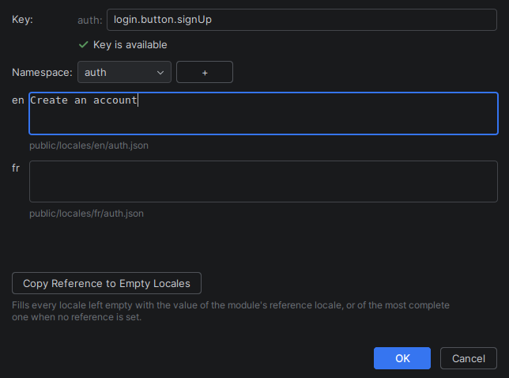
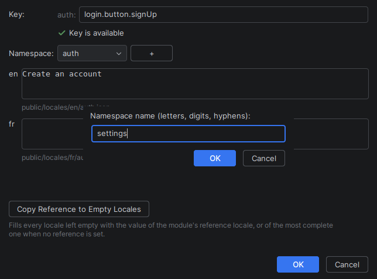

### Tree View

Keys grouped by **namespace**, then by segment. Every key carries its status three times over — an icon, per-locale badges (`EN✓ FR✗`) and a colour — so it survives a colour-blind reader or a custom theme; a branch shows how many of its keys are fully translated (`12/14 (86%)`), and a namespace row how complete the namespace is.

- **Enter** or double-click edits the key — the dialog can also delete it from every locale —, **F4** opens the translation file at the key, typing jumps to a key
- Right-click: edit, open file, copy key
- A permanent legend sits at the bottom
- The keys of the default namespace sit in a group named after it — `common (default)` — when the configuration names a single one

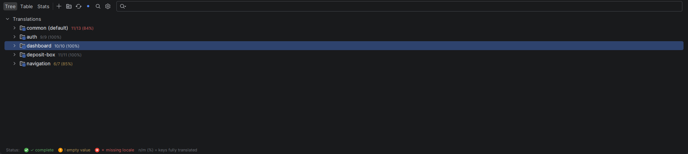
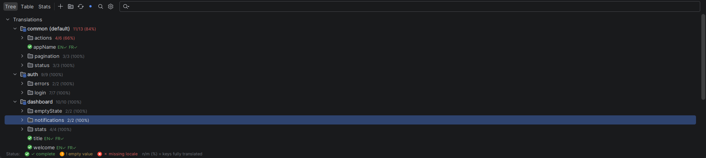

### Table View

Flat table: a **Namespace** column while the rows span several namespaces, the **Key**, one column per locale, and **Usage**. Every cell says what it is — a *Missing* or *Empty* word with an icon, the value otherwise — before being tinted.

- Locale cells are **editable in place**; the value is written straight to the file, and the entry created when the locale lacks it
- Namespace filter in the dropdown; right-click the header to hide locale columns
- Status filter: keys missing or empty in a shown locale, with no reference found, or holding a value another key of the same namespace holds too
- **Scan Orphans** (toolbar) fills the Usage column; keys reached only through a dynamic key (`` t(`status.${kind}`) ``) are told from unused ones
- Keys used outside the code (received from an API, stored elsewhere) can be listed in the settings, *Keys used outside the code* (`errors.*`, `*.label`, `common:status.ok`): they show as *Kept* and are never offered for deletion
- Right-click: edit, open file, delete a key with no reference found

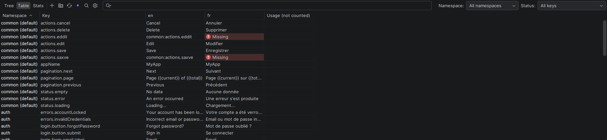
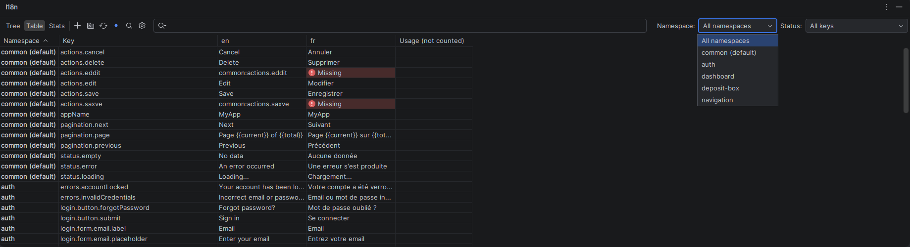
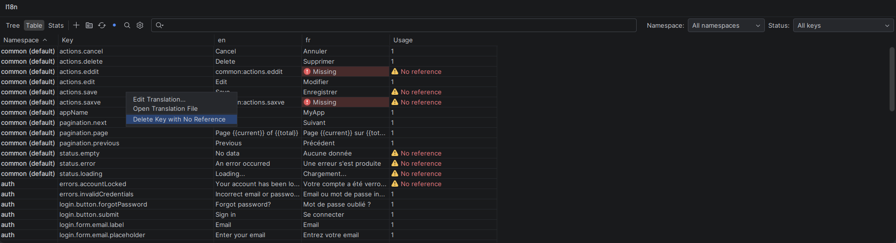

### Reviews

A module with a `.i18n-reviews/` folder keeps a review per key and locale, versioned with the code so the whole team shares it. The table then shows each cell's review (an icon and a tooltip), the status filter adds *To review*, *Source changed* and *Changes requested*, and right-clicking locale cells approves them, requests changes, marks them for review or opens their thread.

- **Source changed**: the value is still the one decided on, but the key's text in the module's reference locale changed since. An approval made on "Save" no longer holds once the source says "Save and close". The cell counts as *to review*, and its tooltip shows the source as it reads now: approve the value if it still fits, or translate it again. The reference locale itself is never *source changed*
- A review decided before 1.13.0 records no source: it reads as before until its next decision
- Have the whole team on 1.13.0 or later: an older version rewriting a locale's review file drops the sources recorded in it. That never turns into a false approval, but the locale stops telling stale translations until their next decision

### Keys Synchronizer

Propagates missing keys across all locales in one click. When a key exists in `en.json` but not `fr.json`, the synchronizer creates the missing entry. A **batch placeholder dialog** lets you fill in values for all missing keys at once.

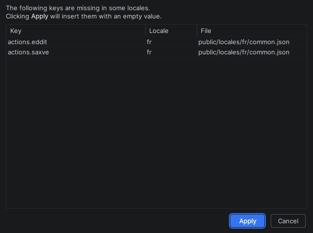

### Stats

Coverage as a matrix: one row per **namespace** under a **Total** row, one column per **locale**. A cell reads `11/13 [=====    ] 84.6%` — translated keys over the namespace's keys, a bar tinted by tier (≥ 90% complete, ≥ 50% partial, below incomplete), the percentage.

Clicking a cell lists that namespace's untranslated keys in that locale — **missing** and **empty** told apart, each next to what it says in the reference locale. **Enter** or a click opens the translation dialog on the key; **F4** opens the reference file.

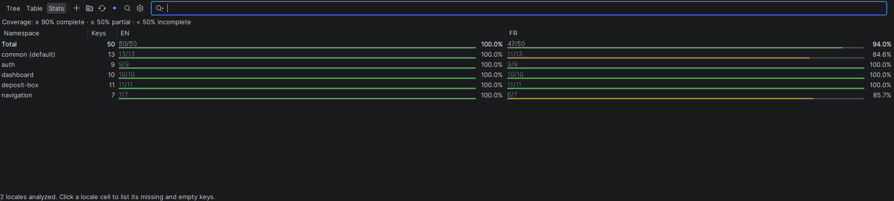
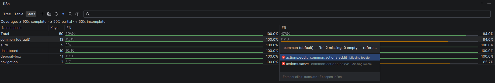

### Multi-Module Support

A monorepo is described as **modules** in the settings (root directory, path template, key template, framework preset). With two or more, the toolbar's module selector switches the three views from one module to the next; a code file inside a module's root directory resolves its keys against that module's translation files only. The root directory is the application's folder (`apps/shop`), not its translations folder: a module rooted at `apps/shop/public/locales` owns no code file, and the application's keys are then resolved against every module's files. Untick a module's **Active** box to put it aside: its translation files are no longer read, the code under its root directory is neither checked nor completed, and the module selector leaves it out — what *Excluded directories* did by hand for the applications you are not working on. [examples/monorepo-react](examples/monorepo-react/README.md) is a four-application monorepo to try it on.

## Configuration

**Settings > Tools > i18n Support Plus Configuration**

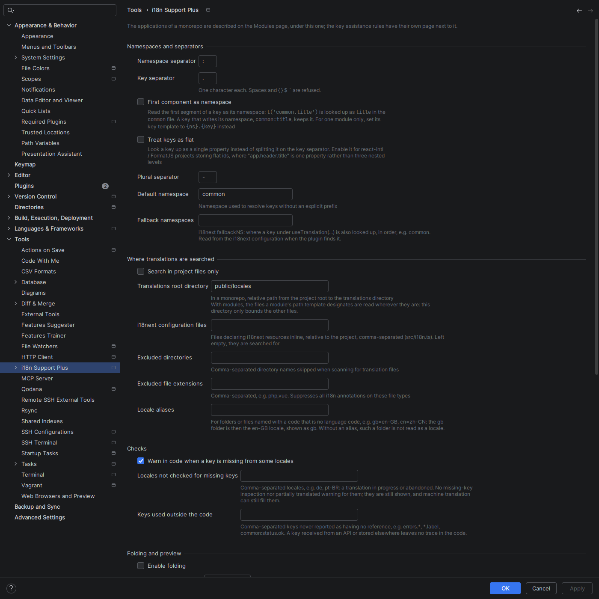

### Namespaces and separators

| Setting | Default | Description |
|---------|---------|-------------|
| Namespace separator | `:` | Separates namespace from key (e.g. `common:key`) |
| Key separator | `.` | Separates nested keys (e.g. `parent.child`) |
| Plural separator | `-` | Separates plural forms |
| Default namespace | `translation` | Namespace(s) used for keys without a prefix, separated by `;`, `,` or whitespace |
| Fallback namespaces | _(empty)_ | i18next `fallbackNS`: where a key under `useTranslation(…)` is also looked up, in order, when its own namespace lacks it. Read from the i18next configuration file when the plugin finds one |
| First component as namespace | `false` | Treat the first key component as the namespace (vue-i18n) |
| Treat keys as flat | `false` | Look a key up as a single property, without splitting (react-intl / FormatJS) |

### Where translations are searched

| Setting | Default | Description |
|---------|---------|-------------|
| Search in project files only | `true` | Skip libraries and external roots |
| Translations root directory | *(empty)* | In a monorepo, path from the project root to the translations directory |
| i18next configuration files | *(empty)* | Files declaring i18next `resources` inline, comma-separated (`src/i18n.ts`) |
| Excluded directories | *(empty)* | Directory names skipped when scanning for translation files |
| Locale aliases | *(empty)* | Folder or file names that are no language code, mapped to their locale: `gb=en-GB, cn=zh-CN`. A `gb/` folder is then the `en-GB` locale, shown as `gb`, with its plural forms. Without an alias, a folder named with a country code (`gb`, `jp`, `ua`) is not read as a locale |
| Excluded file extensions | *(empty)* | Extensions on which annotations are suppressed (`php,vue`) |

### Modules

One entry per application of a monorepo: a **name**, a **root directory**, a **path template** designating its translation files (`locales/{lang}/{ns}.json`, `messages/{lang}.yml`), an optional **file template**, a **key template** saying how its code writes keys (`{ns}:{key}`, `{ns}.{key}`, `{key}`) and a framework **preset**. A diagnostics panel underneath says what each template resolves to.

A module can also write its own call at extraction, the **call template**: `translate({key})` turns `t('a.b', { name })` into `translate('a.b', { name })`. `{text}` writes the text extracted, quoted, where the call reads a default value: `t({key}, {text})` gives `t('greeting', 'Hello')`, for vue-i18n 9's `t(key, defaultMsg)` or a wrapper of your own. With i18next, *Write the default value in the call* does it without a template.

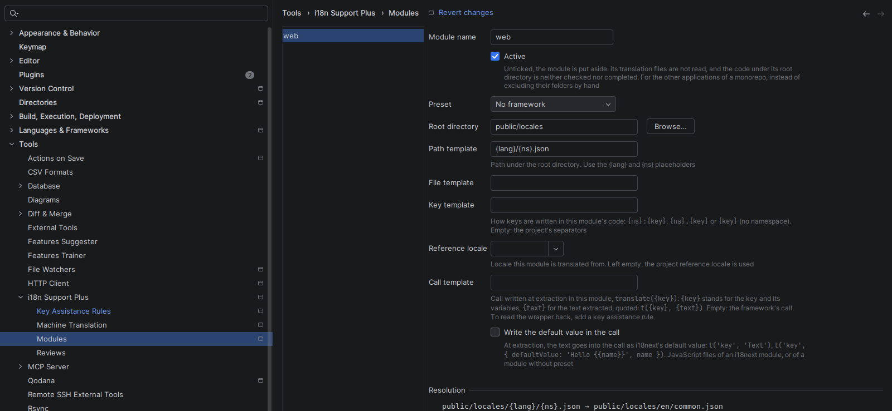

### Key assistance rules

Rules make other calls behave like `t`: a **trigger** (`translate`, `i18n.translate`, `__`) turns a function into a translation call, an **exclude** rule takes one out. Each rule can be limited to a language (`js`, `php`) and constrained on the file path, the file's imports or the key — exact, prefix or regular expression, optionally negated.

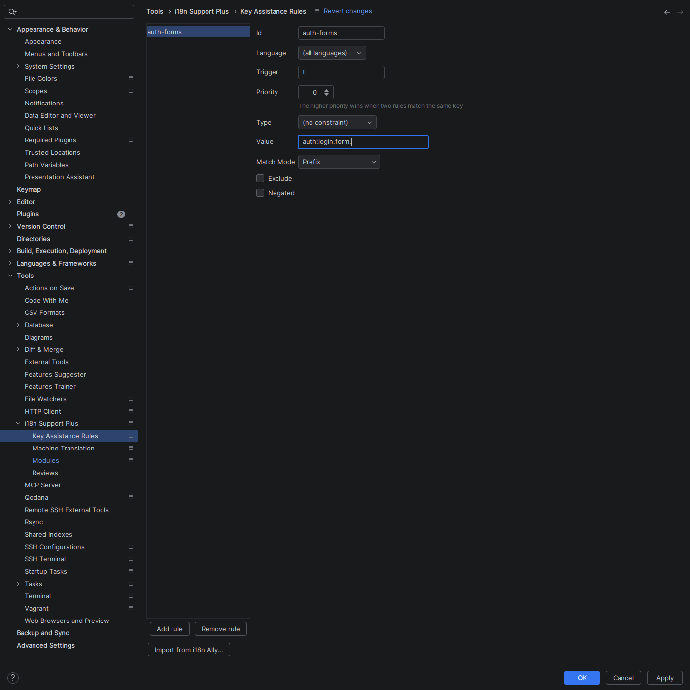

**Migrating from i18n Ally.** *Import from i18n Ally…*, under the rules, reads the project's `.vscode/i18n-ally-custom-framework.yml` — or the file you pick when there is none — and shows what it would add before adding anything:

| i18n Ally | Here |
|-----------|------|
| `usageMatchRegex` that is a plain call on the key — `` [^\w\d]t\(['"`]({key})['"`] ``, `i18n\.t\(`, `\$t\(`, `__\(` | A trigger rule (`t`, `i18n.t`, `$t`, `__`), one per language |
| `languageIds` | The rule language: `js` for `javascript`, `typescript`, `javascriptreact`, `typescriptreact` and `vue`; `php` for `php`. Other languages are reported |
| `refactorTemplates` | A proposed *call template* (`$t('$1')` → `$t({key})`, the `{…}` of `{$t('$1')}` dropped), listed for you to set on a module: the import never changes a module |
| `monopoly`, `scopeRangeRegex` | Reported: no equivalent |

The import is partial by design: a rule names a function, whose calls the plugin resolves — which is what gives completion, navigation and rename — while i18n Ally matches free text. Any other regex (an alternation, a key not passed first, JSX attributes…) is listed as not imported, with the reason, as are rules that an existing one already declares. The rules are added to the list once confirmed, and saved with *Apply*.

### Folding and preview

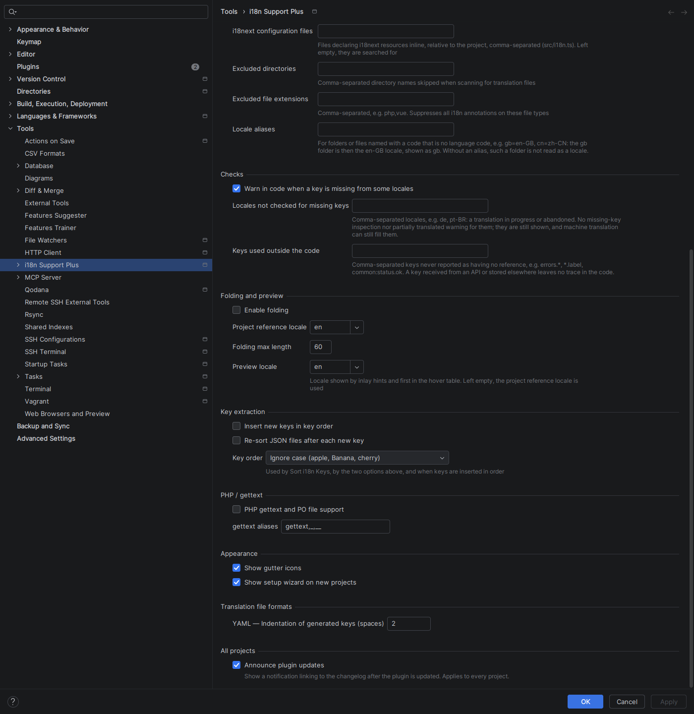

| Setting | Default | Description |
|---------|---------|-------------|
| Enable folding | `false` | Show translation values inline in place of the keys |
| Preferred folding language | `en` | Locale used by folding |
| Folding max length | `20` | Max characters shown in a folded translation |
| Preview locale | *(empty)* | Locale shown by inlay hints, first in the hover table and opened by Ctrl+click; the folding language when empty |

### Key extraction

| Setting | Default | Description |
|---------|---------|-------------|
| Extract translation sorted by key | `false` | Insert extracted keys in alphabetical order |
| Sort keys alphabetically | `false` | Keep JSON translation files sorted after every key creation |
| Key order | Ignore case | Order used by the two settings above and by *Sort i18n Keys Alphabetically*: *Ignore case* (`apple`, `Banana`, `cherry`), *Character code, like the IDE* (`Banana`, `apple`, `cherry`), the order of the IDE's *Sort properties alphabetically*, or *Natural* (`item1`, `Item2`, `item10`), case ignored and numbers compared by value |

### Inspections

| Setting | Default | Description |
|---------|---------|-------------|
| Partially translated keys inspection | `false` | Warn when a key exists in some locales but not others |

### PHP / gettext

| Setting | Default | Description |
|---------|---------|-------------|
| PHP gettext & plain object files support | `false` | Enable gettext/PO file support |
| gettext aliases | `gettext,_,__` | Function names recognized as gettext calls |

### Translation file formats

Per-format settings; the first one is the **indentation of the keys generated in YAML files** (2 spaces). JSON follows the IDE's code style.

### Appearance

| Setting | Default | Description |
|---------|---------|-------------|
| Show gutter icons | `true` | Display resolution badges in the editor gutter |
| Show setup wizard on new projects | `true` | Run the wizard the first time an unconfigured project opens |
| Announce plugin updates | `true` | After an update, a notification linking to the changelog (applies to every project) |

## Requirements

- IntelliJ IDEA 2025.2+ (build 252–263.*), verified against 2025.2, 2025.3, 2026.1, 2026.2 and 2026.3
- On 2025.1, the last compatible version is 1.11.1
- Java 21+

### Plugin Dependencies

| Plugin | Required | Enables |
|--------|:--------:|---------|
| JavaScript | Yes | Core JS/TS support |
| Vue.js | No | vue-i18n support (`$t`, `$tc`, `$te`, `<i18n-t keypath>`, `v-t`) |
| YAML | No | `.yaml`/`.yml` translation files |
| PHP | No | PHP language support |
| Localization | No | PO/POT gettext files |
| Angular | No | Translation pipes and Transloco directives in Angular templates (`.html`) |
| Blade | No | Keys in Blade views (`{{ __('key') }}`, `@lang`) |
| Svelte | No | Keys in `.svelte` components |
| Astro | No | Keys in `.astro` components |
| Git | No | *Compare with Branch* (translation changes of a branch) |
| MCP Server | No | The tools AI agents call (2025.2.6+) |

## Installation

### From JetBrains Marketplace

Search for **"I18n Support Plus"** in **Settings > Plugins > Marketplace**.

### From Source

```bash
git clone https://github.com/IBRAHIMDANS/i18nSupportPlus.git
cd i18nSupportPlus
./gradlew buildPlugin
# Output: "build/distributions/i18n Support Plus-<version>.zip"
```

Then install via **Settings > Plugins > ⚙️ > Install Plugin from Disk**.

## Contributing

See [CONTRIBUTING.md](CONTRIBUTING.md) for contributor setup, run/test commands, architecture notes, conventions, and troubleshooting tips.

## Credits

Originally created by [Evgeniy Nyavro](https://github.com/nyavro/i18nPlugin).

Maintained by [Ibrahim Dansoko](https://github.com/IBRAHIMDANS). Licensed under [MIT](LICENSE).
