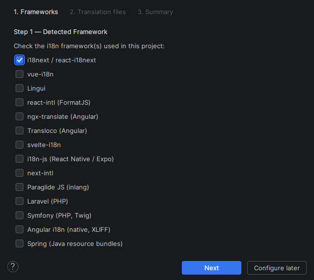
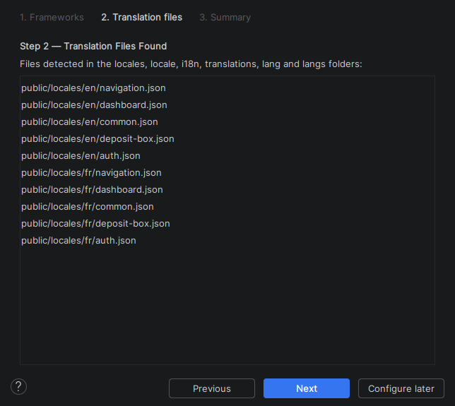
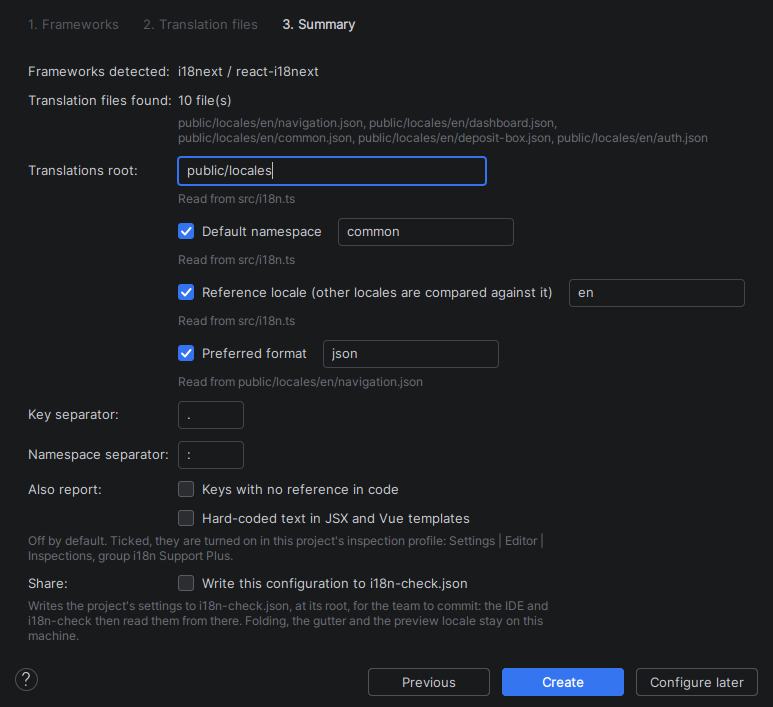
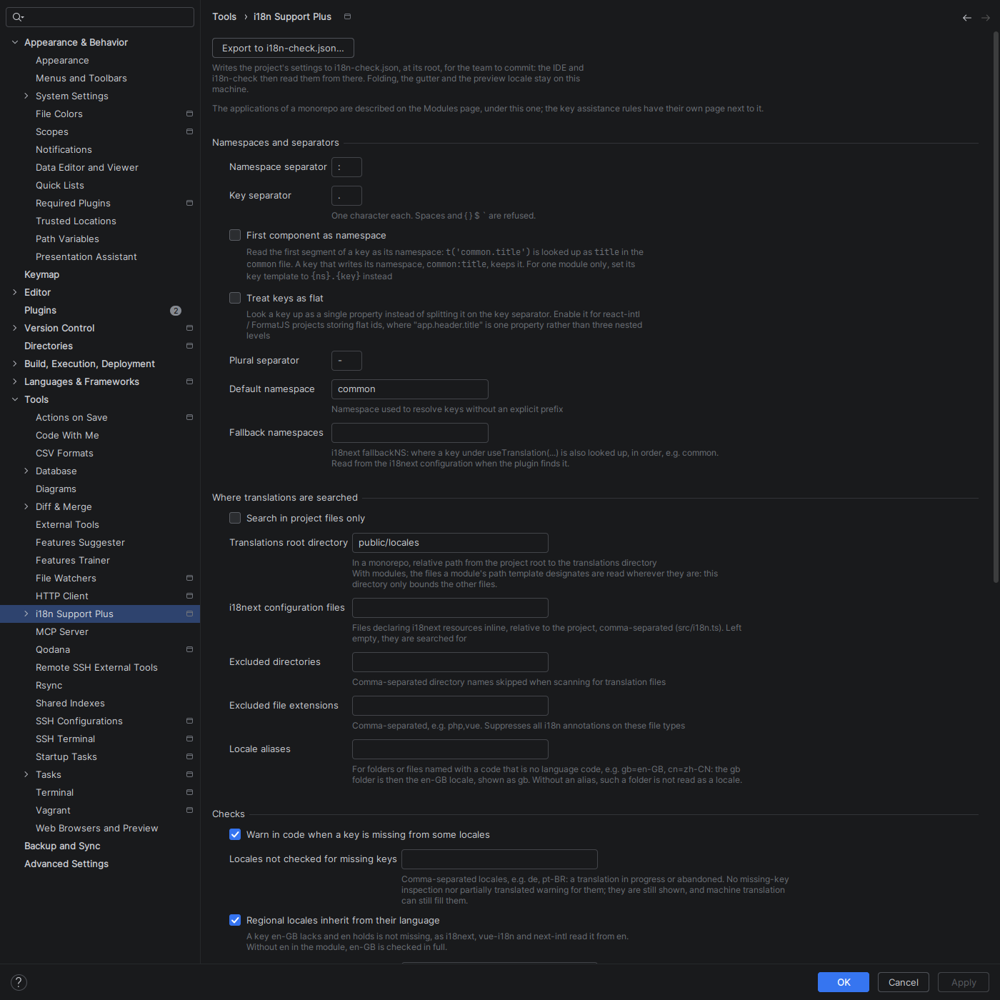
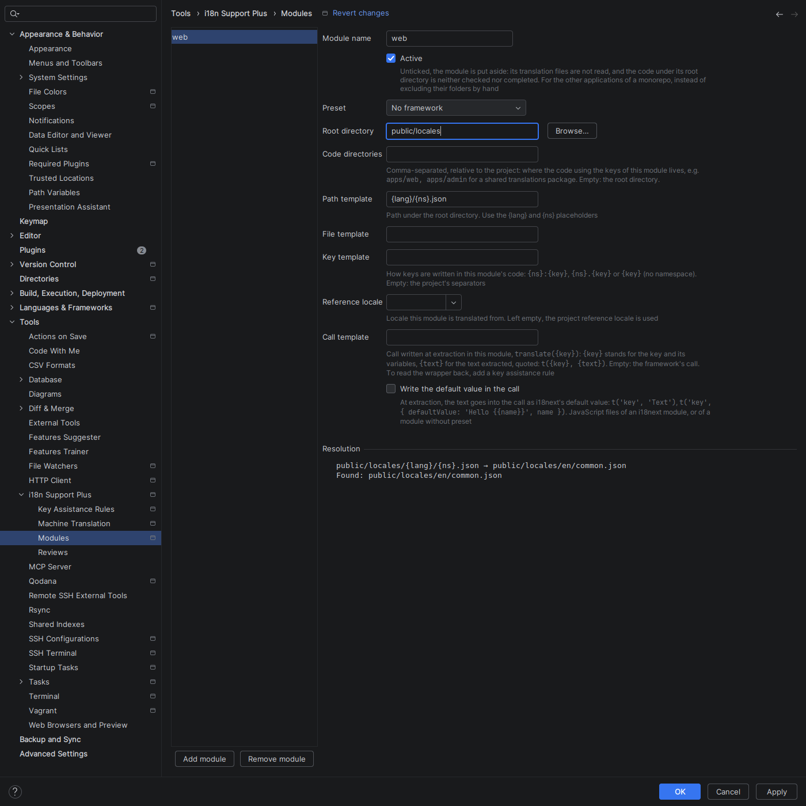
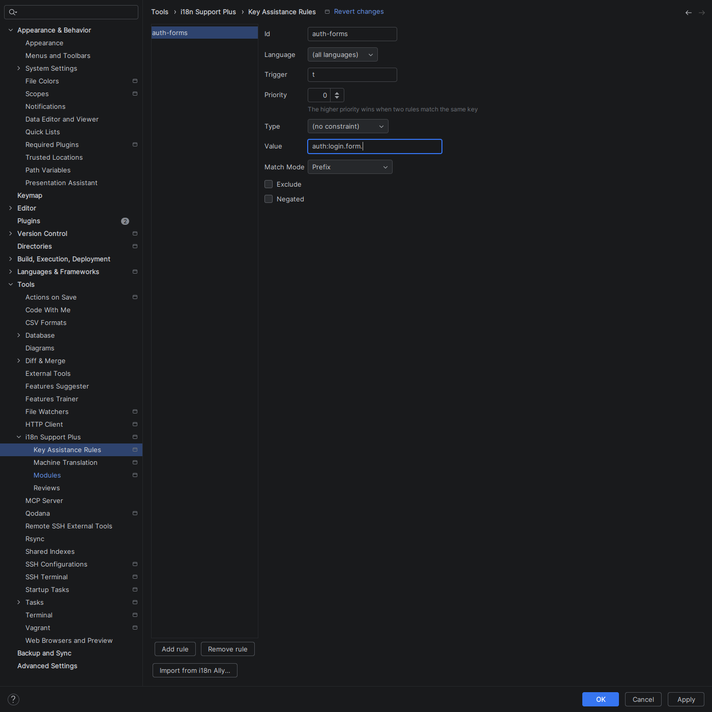
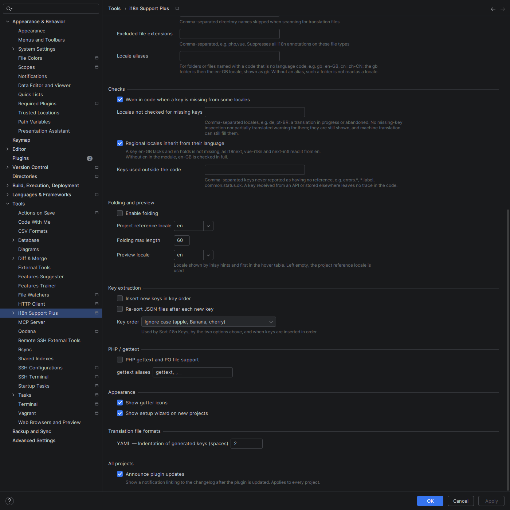

# Setup and configuration

The setup wizard, and every setting of the plugin.

[← Back to the README](../README.md)

## Setup Wizard

On first launch, a wizard guides you through configuration in 3 steps:

1. **Framework detection** — auto-detects i18next, vue-i18n, next-intl, lingui, react-intl, ngx-translate, Transloco, svelte-i18n, i18n-js or Paraglide JS from your `package.json`, Laravel from your `composer.json`, and Angular i18n from `@angular/localize` or an `angular.json` listing `i18n.locales`. It also reads, without running them, `next-i18next.config.js`, `lingui.config.*`, `transloco.config.*`, `i18next.config.*`, `nuxt.config.*` and the `backend.loadPath` of your i18next init: their literal values fill in the summary, each marked with the file it was read from, and a value built at runtime is left out
2. **Translation file discovery** — scans for `.json`, `.yaml`, `.yml`, `.po` and `.pot` files in `locales/`, `locale/`, `i18n/`, `translations/`, `lang/` and `langs/` folders (PO/POT support requires the optional **Localization** plugin — see Plugin Dependencies)
3. **Summary** — review and apply the configuration. In a monorepo, where the catalogues sit in several applications (`apps/shop/public/locales`, `apps/admin/public/locales`), it proposes one module per application, ticked by default: each is rooted at the application's folder (the one holding its `package.json` or `composer.json`, else the folder above `public/`, `src/`, `locales/`…), named after it, and given the framework its own manifest declares. Untick a module to put it aside (see *Modules*)

You can reopen it at any time from **Tools > i18n Support Plus > Run Setup Wizard…**.

## Configuration

**Settings | Tools | i18n Support Plus**, with four pages below it: **Modules** (the applications of a monorepo), **Key Assistance Rules**, **Machine Translation** (see [Machine Translation](translation.md#machine-translation)) and **Reviews** (the name your reviews are signed with). The locale fields list the project's locales and still accept one typed by hand.

### Share the configuration with your team

`.idea/i18nSettings.xml` is often kept out of version control, so each developer used to run the setup wizard again. Click **Export to i18n-check.json…** at the top of the settings page: the project's settings are written to `i18n-check.json` at its root, for the team to commit. Once the file is there, the IDE reads the settings it names from it, and so does [`i18n-check`](checks.md#command-line-check) in CI.

- It takes the names of the settings below: `translationsRoot`, `excludedDirectories`, `jsConfiguration`, `defaultNs`, `fallbackNs`, `nsSeparator`, `keySeparator`, `pluralSeparator`, `firstComponentNs`, `flatKeys`, `gettext`, `gettextAliases`, `foldingPreferredLanguage` (the project reference locale), `ignoredLocales`, `localeAliases`, `keptKeys`, and `modules` (`name`, `rootDirectory`, `pathTemplate`, `fileTemplate`, `keyTemplate`, `preset`, `referenceLocale`, `callTemplate`, `writeDefaultValue`, `enabled`).
- A setting the file names wins over the IDE's, and is greyed out on the settings page: change it in the file, which **Edit i18n-check.json** opens. The others — folding, the gutter, the preview locale, inspections — stay on each machine.
- A module's *Active* box stays on each machine too: *Focus on This Module* sets an application aside for you only. A module the file sets aside (`"enabled": false`) stays aside for everyone.
- The file is read again as soon as it is saved. A name it does not know, or a file that does not parse, is reported in a notification, and the IDE keeps its own settings until it is fixed.

### Namespaces and separators

| Setting | Default | Description |
|---------|---------|-------------|
| Namespace separator | `:` | Separates namespace from key (e.g. `common:key`) |
| Key separator | `.` | Separates nested keys (e.g. `parent.child`) |
| Plural separator | `-` | Separates plural forms |
| Default namespace | `translation` | Namespace(s) used for keys without a prefix, separated by `;`, `,` or whitespace. Left empty, the `defaultNS` of the project's `i18next.init({…})` — or `extract.defaultNS` of `i18next.config.ts` — is used, and the settings page says which file it was read from. `i18n-check` does not read those files: set the default namespace in `i18n-check.json` for the CLI |
| Fallback namespaces | _(empty)_ | i18next `fallbackNS`: where a key under `useTranslation(…)` is also looked up, in order, when its own namespace lacks it. Read from the i18next configuration file when the plugin finds one |
| First component as namespace | `false` | Treat the first key component as the namespace (vue-i18n) |
| Treat keys as flat | `false` | Look a key up as a single property, without splitting (react-intl / FormatJS) |

### Where translations are searched

| Setting | Default | Description |
|---------|---------|-------------|
| Search in project files only | `true` | Skip libraries and external roots |
| Translations root directory | *(empty)* | Path from the project root to the translations directory. With modules, the files a module's path template designates are read wherever they are: this directory only bounds the other files |
| i18next configuration files | *(empty)* | Files declaring i18next `resources` inline, comma-separated (`src/i18n.ts`). Left empty, the plugin finds them: the file that imports `i18next` and calls `.init({…})` or `createInstance({…})`, whatever its name, and `i18next.config.*` at the project root |
| Excluded directories | *(empty)* | Directory names skipped when scanning for translation files |
| Locale aliases | *(empty)* | Folder or file names that are no language code, mapped to their locale: `gb=en-GB, cn=zh-CN`. A `gb/` folder is then the `en-GB` locale, shown as `gb`, with its plural forms. Without an alias, a folder named with a country code (`gb`, `jp`, `ua`) is not read as a locale |
| Excluded file extensions | *(empty)* | Extensions on which annotations are suppressed (`php,vue`) |

### Checks

| Setting | Default | Description |
|---------|---------|-------------|
| Warn in code when a key is missing from some locales | `false` | Warn when a key exists in some locales but not others |
| Locales not checked for missing keys | *(empty)* | Comma-separated locales (`de, pt-BR`) left out of the missing-key checks: a translation in progress or abandoned |
| Keys used outside the code | *(empty)* | Comma-separated keys never reported as having no reference (`errors.*`, `*.label`): a key received from an API leaves no trace in the code |

### Modules

*Settings | Tools | i18n Support Plus | Modules*. One entry per application of a monorepo: a **name**, a **root directory**, a **path template** designating its translation files (`locales/{lang}/{ns}.json`, `messages/{lang}.yml`), an optional **file template**, a **key template** saying how its code writes keys (`{ns}:{key}`, `{ns}.{key}`, `{key}`) and a framework **preset**. A diagnostics panel underneath says what each template resolves to.

A module can also write its own call at extraction, the **call template**: `translate({key})` turns `t('a.b', { name })` into `translate('a.b', { name })`. `{text}` writes the text extracted, quoted, where the call reads a default value: `t({key}, {text})` gives `t('greeting', 'Hello')`, for vue-i18n 9's `t(key, defaultMsg)` or a wrapper of your own. With i18next, *Write the default value in the call* does it without a template.

### Key assistance rules

*Settings | Tools | i18n Support Plus | Key Assistance Rules*. Rules make other calls behave like `t`: a **trigger** (`translate`, `i18n.translate`, `__`) turns a function into a translation call, an **exclude** rule takes one out. Each rule can be limited to a language (`js`, `php`) and constrained on the file path, the file's imports or the key — exact, prefix or regular expression, optionally negated.

**Migrating from i18n Ally.** *Import from i18n Ally…*, under the rules, reads the project's `.vscode/i18n-ally-custom-framework.yml` — or the file you pick when there is none — and shows what it would add before adding anything:

| i18n Ally | Here |
|-----------|------|
| `usageMatchRegex` that is a plain call on the key — `` [^\w\d]t\(['"`]({key})['"`] ``, `i18n\.t\(`, `\$t\(`, `__\(` | A trigger rule (`t`, `i18n.t`, `$t`, `__`), one per language |
| `languageIds` | The rule language: `js` for `javascript`, `typescript`, `javascriptreact`, `typescriptreact` and `vue`; `php` for `php`. Other languages are reported |
| `refactorTemplates` | A proposed *call template* (`$t('$1')` → `$t({key})`, the `{…}` of `{$t('$1')}` dropped), listed for you to set on a module: the import never changes a module |
| `monopoly`, `scopeRangeRegex` | Reported: no equivalent |

The import is partial by design: a rule names a function, whose calls the plugin resolves — which is what gives completion, navigation and rename — while i18n Ally matches free text. Any other regex (an alternation, a key not passed first, JSX attributes…) is listed as not imported, with the reason, as are rules that an existing one already declares. The rules are added to the list once confirmed, and saved with *Apply*.

### Folding and preview

| Setting | Default | Description |
|---------|---------|-------------|
| Enable folding | `false` | Show translation values inline in place of the keys |
| Project reference locale | `en` | Locale the other locales are compared with and translated from, for a module that sets none; also what folding and hints show when no preview locale is set |
| Folding max length | `20` | Max characters shown in a folded translation |
| Preview locale | *(empty)* | Locale shown by inlay hints, first in the hover table and opened by Ctrl+click; the project reference locale when empty |

### Key extraction

| Setting | Default | Description |
|---------|---------|-------------|
| Insert new keys in key order | `false` | Insert a new key at its place in the *Key order* instead of at the end |
| Re-sort JSON files after each new key | `false` | Sort the whole JSON translation file in the *Key order* after every key creation |
| Key order | Ignore case | Order used by the two settings above and by *Sort i18n Keys*: *Ignore case* (`apple`, `Banana`, `cherry`), *Character code, like the IDE* (`Banana`, `apple`, `cherry`), the order of the IDE's *Sort properties alphabetically*, or *Natural* (`item1`, `Item2`, `item10`), case ignored and numbers compared by value |

### PHP / gettext

| Setting | Default | Description |
|---------|---------|-------------|
| PHP gettext and PO file support | `false` | Enable gettext/PO file support |
| gettext aliases | `gettext,_,__` | Function names recognized as gettext calls |

### Appearance

| Setting | Default | Description |
|---------|---------|-------------|
| Show gutter icons | `true` | Display resolution badges in the editor gutter |
| Show setup wizard on new projects | `true` | Run the wizard the first time an unconfigured project opens |

### Translation file formats

Per-format settings; the first one is the **indentation of the keys generated in YAML files** (2 spaces). JSON follows the IDE's code style.

### All projects

| Setting | Default | Description |
|---------|---------|-------------|
| Announce plugin updates | `true` | After an update, a notification linking to the changelog. The only setting of the page shared by every project |
