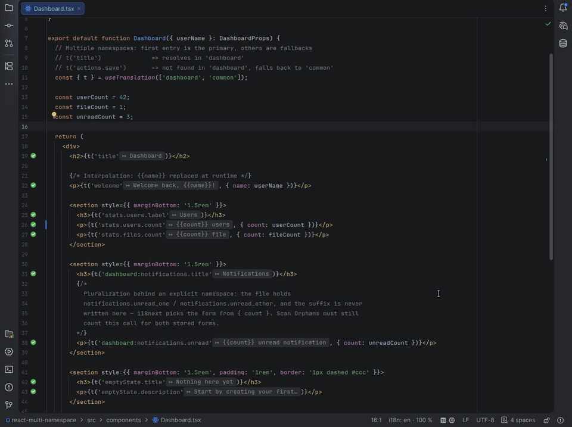
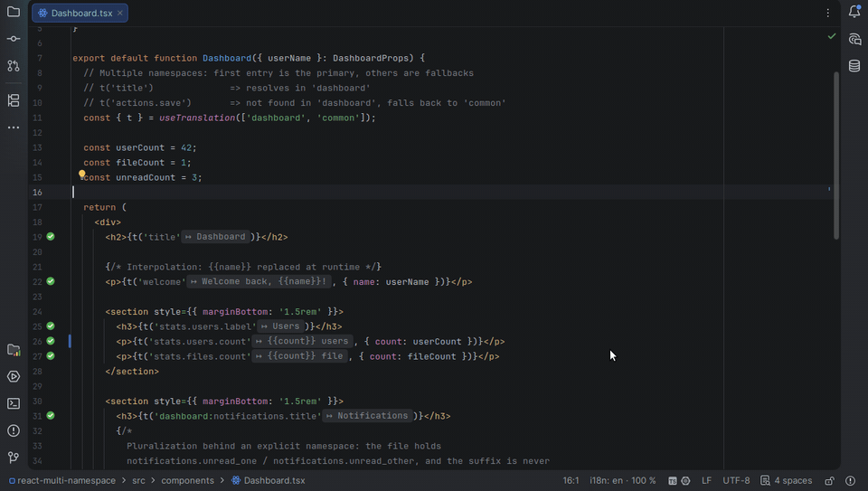
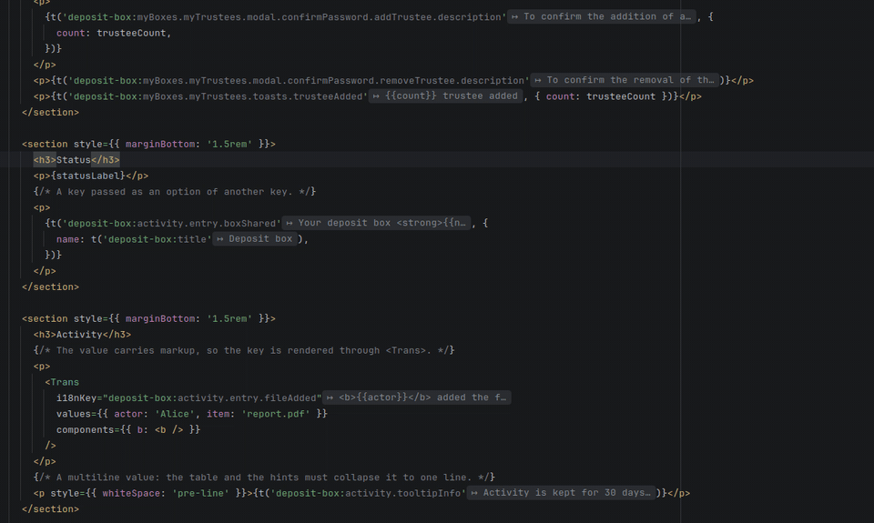
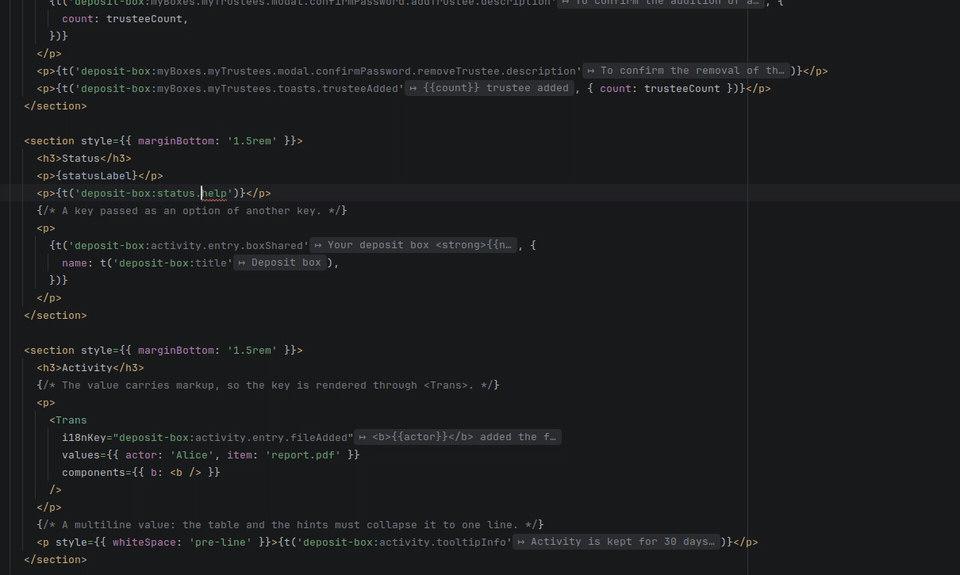

# In the editor

What the plugin shows and does where you write code: key status, navigation, completion, extraction, hints, folding, renaming and quick fixes. Key, namespace, locale, reference and preview locale are defined in [Getting started](getting-started.md#the-words-used-here).

[← Back to the README](../README.md)

## See

### Key status

Each i18n key is highlighted by its status, in the code and as an icon in the gutter:

| Status | Gutter | Meaning |
|--------|:------:|---------|
| Resolved | ✅ green | The key holds a value in every locale |
| Partially translated | ⚠️ yellow | The key exists in some locales but not all; the highlight in the code is opt-in (*Warn in code when a key is missing from some locales*) |
| Unresolved | ❌ red | No locale holds the key, or a segment of the key path does not exist |
| Missing file | ❌ red | The namespace file is not found |
| Object reference | — | The key points to an object instead of a value |
| Plural reference | ✅ green | The key resolves to plural variants (`_one`, `_other`, …) |

Hovering a gutter icon lists the locales; clicking a yellow or red one opens the quick fix creating the missing key. *Show gutter icons* in the settings turns the icons off.

On an unresolved key, **Alt+Enter** also offers *Use 'button.save'* for up to three keys of the file a typo away — a character missing, added, changed, or two swapped in a segment, two edits at most for the whole key — and replaces the key in the call, its namespace kept.

### Inlay Hints

Displays the resolved translation value inline after each i18n key expression, directly in the editor. Toggle via **Editor > Inlay Hints > i18n translations**.

In a JSON or YAML translation file, the reference locale's value follows each value of another locale, or *missing in* the reference when it lacks the key. Toggle via **Editor > Inlay Hints > i18n reference values**.

### Hover Hints

**Ctrl+hover** on an i18n key shows a tooltip with all translations grouped by locale, with missing translations shown as "—" and a navigation link (↗) to the translation file.

### Preview Locale

`i18n: en` in the status bar says which locale inlay hints, hover, Ctrl+click and folding read in. Click it to pick another of the project's locales; **Switch Preview Locale**, under *i18n* in the editor's context menu, cycles through them, ready for a shortcut. Switching only changes the preview: the *Project reference locale* setting, which the other locales are compared with and translated from, stays as it is.

### Code Folding

Replaces i18n keys with their translation values inline for better readability. Toggle with **Show Translations Inline** (under *i18n* in the editor context menu, or *Find Action*; give it a shortcut in *Settings › Keymap*): the files already open fold or unfold at once.

## Navigate

### Navigation

**Ctrl+Click** on any i18n key navigates directly to the translation value in its translation file.

- Opens the **preview locale** (the project reference locale when none is set) rather than asking which file; when that locale lacks the key, every target is offered
- Works with partially resolved keys (navigates to the deepest resolved node)
- Bidirectional: navigate from translation files back to code usage
- A key held by a constant is followed one step — see [Keys held by constants](#keys-held-by-constants)

### Code Completion

Autocomplete i18n keys as you type, with full namespace support. Suggestions are drawn from all translation files in the project.

## Edit

### Key Extraction

Extract hard-coded strings into translation files with the **Extract i18n key** intention (**Alt+Enter**). The dialog proposes a key, shows one field per locale and writes the value into every translation file; variables become interpolations, and one Ctrl+Z undoes the files and the code. *Insert new keys in key order* keeps the files sorted.

Step by step: **Alt+Enter** on the text offers *Extract i18n key*; the dialog proposes the namespace, the key and one value per locale; **+** next to the namespace creates a new one.

In a react-intl project — a module on the `react-intl` preset, or, without modules, a file importing `react-intl` — a JSX text becomes `<FormattedMessage id="key" />` (variables in `values`), and an attribute or a string `intl.formatMessage({ id: 'key' })`, with the name the component gives `useIntl()`. `FormattedMessage` is imported from `react-intl`, merged into the file's import when it has one. Without a `useIntl()` in scope, a string is not extracted — the hint asks for one, and *Batch Extract* lists it unchecked with that reason — while *Internationalize…* gives the component `const intl = useIntl()` and its import. *Write the default value in the call* adds `defaultMessage`; a module's call template still wins.

### Actions on keys

The actions on the key under the caret, or on the file; those working on many keys at once are in [Tool window and bulk actions](tool-window.md#bulk-actions).

| Action | Where | What it does |
|--------|-------|--------------|
| Edit Translation… | editor context menu › *i18n*, *Edit* link of the Ctrl+hover hint | Edit the values of the key under the caret in every locale, or create it when no file holds it |
| Batch Extract i18n Keys… | **Code** menu | Extract several hard-coded strings of a file as keys in one pass |
| Internationalize… | Project view context menu, editor context menu › *i18n* | Replace every hard-coded text of the selected JS/TS and Vue files and folders by a key, after a preview where texts are unchecked and keys edited |
| Move i18n Key to Namespace… | editor context menu › *i18n*, `Ctrl+Alt+Shift+M` | Move a key to another namespace, updating every locale file and code reference |
| Sort i18n Keys | editor context menu › *i18n*, in a translation file | Reorder the file's keys in the *Key order* of the settings, recursively |

### Rename Refactoring

Rename i18n keys across all translation files and source code references with **Shift+F6** — every call site, whether written with its namespace, under a hook namespace or under a key prefix; plural suffixes (`_one`, `_other`) are kept.

With the caret on an intermediate level of a key (`button` in `common:button.save`), or on a property holding other keys in a translation file, **Shift+F6** renames the whole level: `button.*` becomes `actions.*` in every locale and at every call site, a hook's `keyPrefix` included. A level that already exists is refused rather than merged, and keys built at runtime (`` t(`button.${action}`) ``) are listed in the confirmation, not rewritten.

**Shift+F6** on a namespace file (`locales/en/common.json`), or on the folder of a namespace when a module keeps one folder per namespace (`locales/{ns}/{lang}.json`), renames the namespace, with *Rename namespace in every locale and call site* ticked in the rename dialog: the file in every locale, the `common:` prefix of the keys, `useTranslation('common')` and its arrays, `withTranslation`, `getFixedT`, the `ns` option and prop, the `defaultNS` and `fallbackNS` of your i18next setup, the `$t(common:save)` nested in translation values, and the default and fallback namespaces of the settings, `i18n-check.json` included — in one undo. *Preview* lists the call sites before anything changes. Untick the box to rename the file alone; a locale-named file (`en.json`) and a file the plugin does not read as translations keep the IDE's own rename. In a monorepo, the code of another module is left alone.

### Quick Fixes

| Quick Fix | Trigger |
|-----------|---------|
| Create missing key | Unresolved key (inspection `I18nUnresolvedKey`) |
| Create translation file | Missing namespace file annotation |
| Create namespace on the fly | `+` button in Create Translation dialog |

## Dynamic keys

### Keys held by constants

A key held by a constant is followed one step: `t(SAVE_KEY)`, `t(KEYS.save)` (an object of a `const`, `as const` or not) and `t(Keys.Save)` (a string `enum` member) are annotated, hinted and Ctrl+clicked at the call, imported or not; each branch of `const titleKey = cond ? 'a' : 'b'` is annotated where it is written. The constant's literal is the usage *Find Usages* lists and Shift+F6 rewrites, once — from the literal or from the constant's name at the call. A parameter, a reassigned variable or a value computed by a function stays unread.

### Wildcard Traversal

Intermediate `*` wildcards in composite key resolution allow matching any segment at a given position. For example, `a.*.b` matches `a.foo.b`, `a.bar.b`, etc. Useful with dynamic keys where the middle segment varies.
