# In the editor

What the plugin shows and does where you write code: key status, navigation, completion, extraction, hints, folding, renaming and quick fixes.

[← Back to the README](../README.md)

## Annotations

Highlights i18n keys with visual feedback on resolution status:

| Status | Description |
|--------|-------------|
| Resolved key | Key found in all translation files |
| Unresolved segment | Part of the key path doesn't exist |
| Missing file | Referenced namespace file not found |
| Object reference | Key points to a JSON object instead of a value |
| Plural reference | Key resolves to plural variants (`_one`, `_other`, etc.) |
| Partial translation | Key exists in some locales but not all (opt-in) |

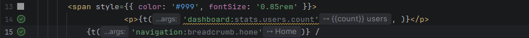
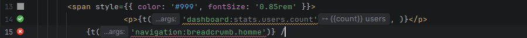
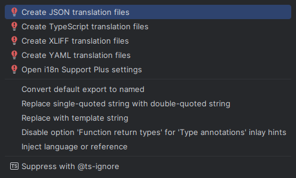

## Navigation

**Ctrl+Click** on any i18n key navigates directly to the translation value in its translation file.

- Opens the **preview locale** (the project reference locale when none is set) rather than asking which file; when that locale lacks the key, every target is offered
- Works with partially resolved keys (navigates to the deepest resolved node)
- Bidirectional: navigate from translation files back to code usage

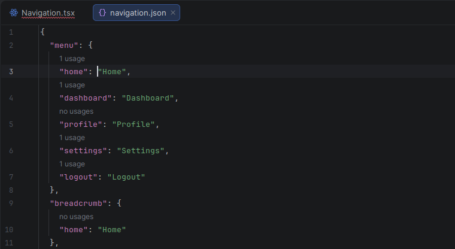

## Code Completion

Autocomplete i18n keys as you type, with full namespace support. Suggestions are drawn from all translation files in the project.

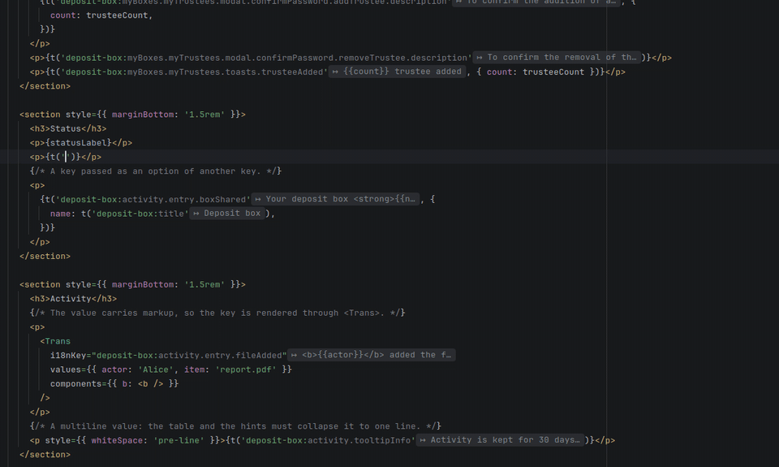

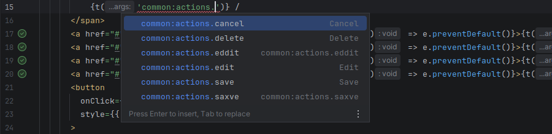

## Key Extraction

Extract hard-coded strings into translation files via **Alt+Enter** intention action. Supports sorted insertion (*Insert new keys in key order* setting).

In a react-intl project — a module on the `react-intl` preset, or, without modules, a file importing `react-intl` — a JSX text becomes `<FormattedMessage id="key" />` (variables in `values`), and an attribute or a string `intl.formatMessage({ id: 'key' })`, with the name the component gives `useIntl()`. `FormattedMessage` is imported from `react-intl`, merged into the file's import when it has one. Without a `useIntl()` in scope, a string is not extracted — the hint asks for one, and *Batch Extract* lists it unchecked with that reason — while *Internationalize…* gives the component `const intl = useIntl()` and its import. *Write the default value in the call* adds `defaultMessage`; a module's call template still wins.

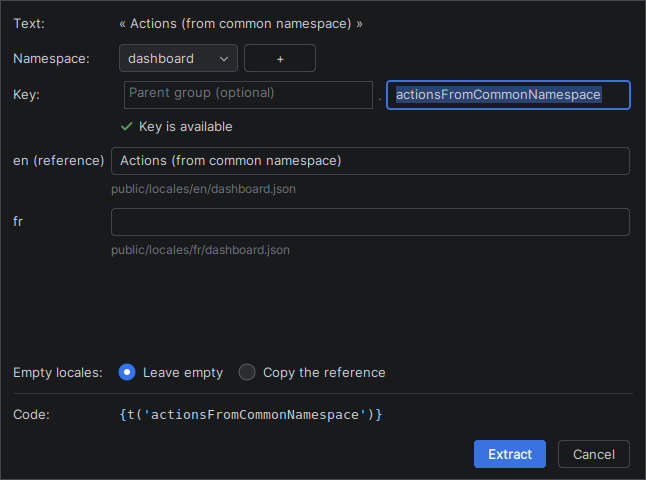
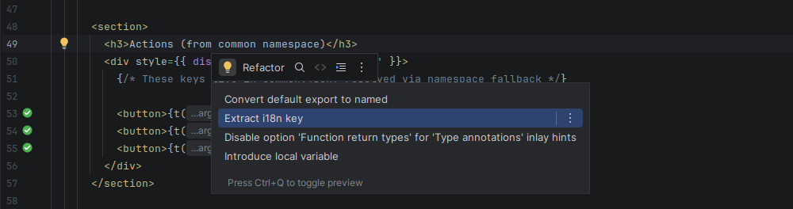
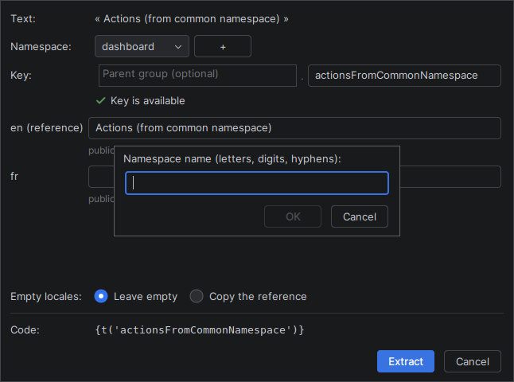
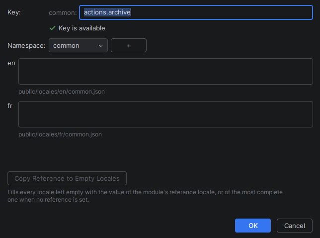

## Gutter Badges

Line markers in the editor gutter indicate key resolution status at a glance:

| Icon | Meaning |
|------|---------|
| ✅ Green | Key resolved in **all** locales |
| ⚠️ Yellow | Key resolved in **some** locales (partial) |
| ❌ Red | Key not found in **any** locale |

Hovering a badge lists the locales; clicking a partial/missing badge triggers the quick fix to create the missing key.

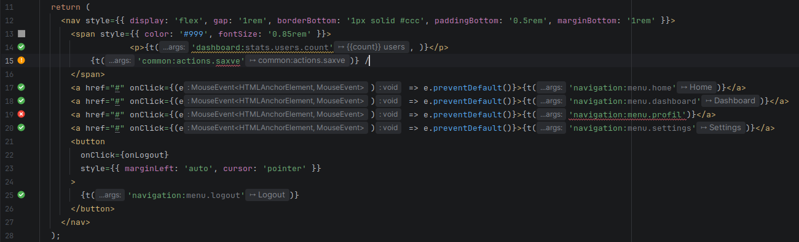
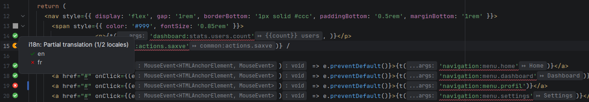

## Inlay Hints

Displays the resolved translation value inline after each i18n key expression, directly in the editor. Toggle via **Editor > Inlay Hints > i18n translations**.

In a JSON or YAML translation file, the reference locale's value follows each value of another locale, or *missing in* the reference when it lacks the key. Toggle via **Editor > Inlay Hints > i18n reference values**.

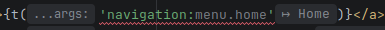

## Hover Hints

**Ctrl+hover** on an i18n key shows a tooltip with all translations grouped by locale, with missing translations shown as "—" and a navigation link (↗) to the translation file.

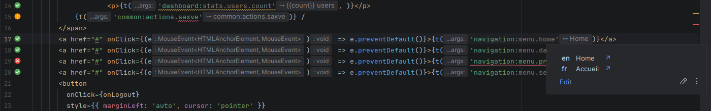

## Preview Locale

`i18n: en` in the status bar says which locale inlay hints, hover, Ctrl+click and folding read in. Click it to pick another of the project's locales; **Switch Preview Locale**, under *i18n* in the editor's context menu, cycles through them, ready for a shortcut. Switching only changes the preview: the *Project reference locale* setting, which the other locales are compared with and translated from, stays as it is.

## Code Folding

Replaces i18n keys with their translation values inline for better readability. Toggle with **Show Translations Inline** (under *i18n* in the editor context menu, or *Find Action*; give it a shortcut in *Settings › Keymap*): the files already open fold or unfold at once.

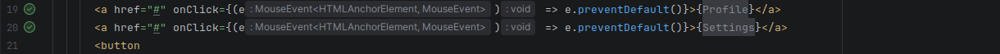
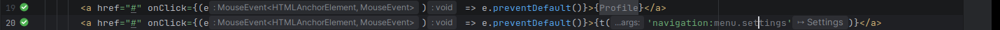

## Rename Refactoring

Rename i18n keys across all translation files and source code references with **Shift+F6** — every call site, whether written with its namespace, under a hook namespace or under a key prefix; plural suffixes (`_one`, `_other`) are kept.

With the caret on an intermediate level of a key (`button` in `common:button.save`), or on a property holding other keys in a translation file, **Shift+F6** renames the whole level: `button.*` becomes `actions.*` in every locale and at every call site, a hook's `keyPrefix` included. A level that already exists is refused rather than merged, and keys built at runtime (`` t(`button.${action}`) ``) are listed in the confirmation, not rewritten.

**Shift+F6** on a namespace file (`locales/en/common.json`), or on the folder of a namespace when a module keeps one folder per namespace (`locales/{ns}/{lang}.json`), renames the namespace, with *Rename namespace in every locale and call site* ticked in the rename dialog: the file in every locale, the `common:` prefix of the keys, `useTranslation('common')` and its arrays, `withTranslation`, `getFixedT`, the `ns` option and prop, the `defaultNS` and `fallbackNS` of your i18next setup, and the default and fallback namespaces of the settings — in one undo. *Preview* lists the call sites before anything changes. Untick the box to rename the file alone; a locale-named file (`en.json`) and a file the plugin does not read as translations keep the IDE's own rename. In a monorepo, the code of another module is left alone.

## Wildcard Traversal

Intermediate `*` wildcards in composite key resolution allow matching any segment at a given position. For example, `a.*.b` matches `a.foo.b`, `a.bar.b`, etc. Useful with dynamic keys where the middle segment varies.

## Quick Fixes

| Quick Fix | Trigger |
|-----------|---------|
| Create missing key | Unresolved key annotation |
| Create translation file | Missing namespace file annotation |
| Create namespace on the fly | `+` button in Create Translation dialog |

