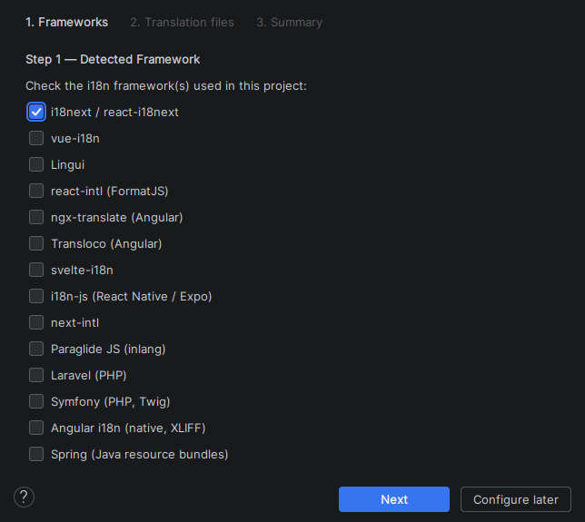
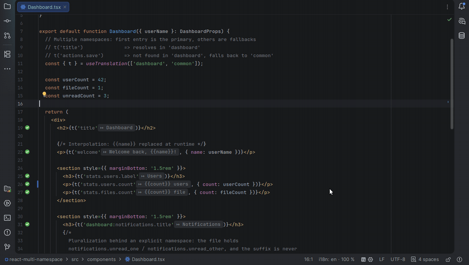
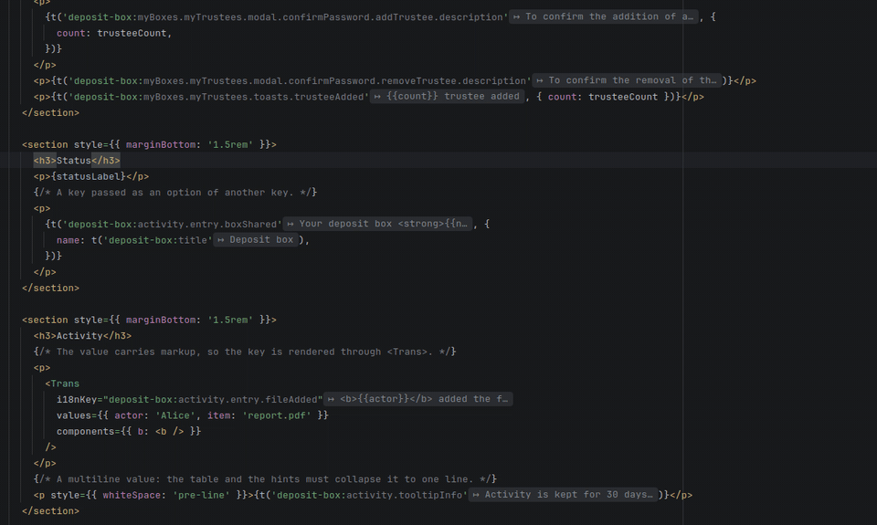
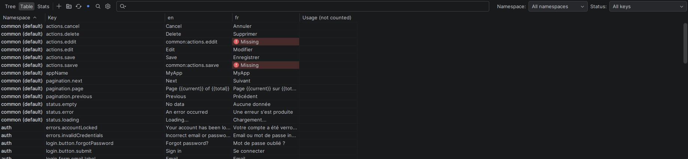
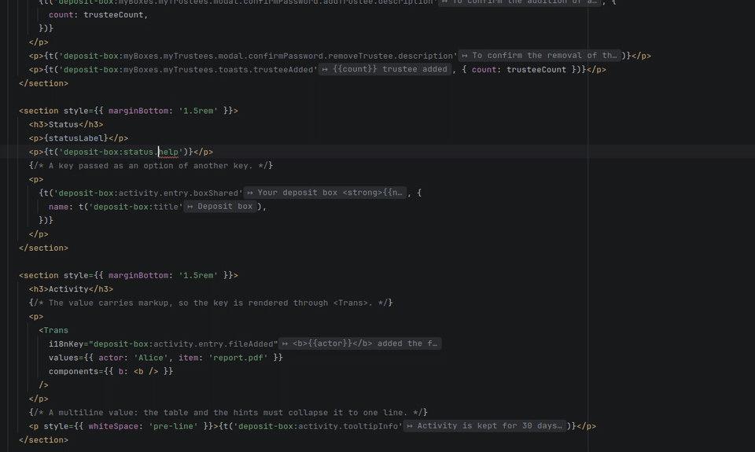

# Getting started

From the installation to your first keys, in ten minutes. The reference pages, one per topic, are listed at the end and in the [README](../README.md#contents).

[← Back to the README](../README.md)

## The words used here

When an app is translated into several languages, every text in the code becomes a **key**, and its wording lives in one file per language. The pages of this documentation use these words for it:

- **Key** — the identifier a text is called by in the code: `user.name` in `t('user.name')`. A dot separates its levels, as the translation file nests them (`{ "user": { "name": "Name" } }`).
- **Namespace** — the translation file a key lives in, when a project keeps several: `common` in `t('common:user.name')`, or `useTranslation('common')`. A key written without one is looked up in the **default namespace**, `translation` for i18next. Laravel and Symfony call it the file or the domain, and vue-i18n projects usually have none.
- **Locale** — a language the app is translated into: `en`, `fr`, `pt-BR`. One file, or one folder, per locale.
- **Reference locale** — the locale the others are compared with and translated from, where a new key is written first. `en` unless the settings say otherwise (*Project reference locale*, or a module's own).
- **Preview locale** — the locale the editor shows: inline hints, hover, Ctrl+click and folding read in it. `i18n: en` in the status bar says which one; click it to switch. The reference locale until you pick another.
- **Translation files** — the JSON, YAML, PO, XLIFF, PHP or TS/JS files holding the values, also called catalogues. Where they are and how they are named is what the setup wizard finds out.
- **Module** — one application of a monorepo, with its own translation files, code and framework. A project with a single application has none.

## 1. Install the plugin

In the IDE, **Settings › Plugins › Marketplace**, search for **I18n Support Plus** and install it, or click *Install* on its [Marketplace page](https://plugins.jetbrains.com/plugin/30971-i18n-support-plus). It installs in any IntelliJ-based IDE 2025.2 or later ([Requirements](../README.md#requirements)); the keys in JavaScript and TypeScript code need the JavaScript plugin (WebStorm, IntelliJ IDEA Ultimate, PhpStorm), and Vue, PHP, YAML, Svelte and Astro files their own, listed under [Plugin Dependencies](../README.md#plugin-dependencies).

No project at hand? Open [examples/react-multi-namespace](../examples/react-multi-namespace), a React application with two locales and three namespaces, the one the steps below are written for.

## 2. Let the wizard configure the project

The first time a project with translation files opens, the setup wizard starts. It can also be run at any time from **Tools › i18n Support Plus › Run Setup Wizard…**.

1. It detects the framework from `package.json` or `composer.json` — i18next, vue-i18n, next-intl, Laravel, Symfony and the others — and reads the configuration files it knows (`i18next.config.*`, `nuxt.config.*`…) without running them.
2. It finds the translation files in the usual folders (`locales/`, `i18n/`, `translations/`, `lang/`…).
3. It shows what it found — files, locales, namespaces, separators, and one module per application in a monorepo — for you to adjust and apply.



Everything it sets can be changed later in *Settings | Tools | i18n Support Plus*; the whole of it is in [Setup and configuration](configuration.md). To share the configuration with the team, click **Export to i18n-check.json…** on that page and commit the file.

## 3. Read your first key

Open a component that calls `t(…)`. Each key is now highlighted by its status, with an icon in the gutter: green when every locale holds it, yellow when some lack it, red when none does. Its value follows it as an inline hint, in the preview locale.

- **Ctrl+hover** a key: a table of its value in every locale, a dash where one is missing, and a link to the file.
- **Ctrl+click** it: the translation file opens on the value. From a translation file, Ctrl+click on a key goes back to the code using it.
- Type `t('` and let completion offer the keys that really exist, namespaces included, each with its value.



Folding goes one step further: **Show Translations Inline**, under *i18n* in the editor's context menu, replaces every key by its value in the open files, and back. Details: [In the editor](editor.md).

## 4. Extract a hard-coded text

Put the caret on a text written as is in the component — `<button>Save</button>` — press **Alt+Enter** and choose **Extract i18n key**. The dialog proposes a key, shows one field per locale, and writes the value into every translation file at once; the code gets the call, `t('actions.save')`. Variables become interpolations, and one Ctrl+Z undoes the files and the code.



A whole file or folder at once: **Internationalize…** in the project view's context menu, after a preview where each text can be unchecked. Details: [Key Extraction](editor.md#key-extraction).

## 5. Find what is missing

Open the **I18n** tool window (bottom panel, or *View › Tool Windows › I18n*).

- **Stats** gives the coverage of each namespace in each locale; click a cell to list the untranslated keys, with what they say in the reference locale.
- **Table** shows one column per locale, editable in place; its status filter keeps the keys missing or empty somewhere.
- **Sync Keys…** in the toolbar creates in every locale the keys it lacks, with a dialog to fill the values.



Back in the code, a red key is fixed where it stands: Alt+Enter, **Create missing key**, and the value is written in every locale.



Details: [Tool window and bulk actions](tool-window.md).

## 6. Translate the gaps, if you want to

Machine translation is off until a project turns it on, in *Settings | Tools | i18n Support Plus | Machine Translation*: a local Ollama, so that nothing leaves the machine, or DeepL, LibreTranslate, Google and any OpenAI-compatible API. Then **Fill Missing Translations…** (*Tools › i18n Support Plus*) translates what a locale lacks from the reference locale, after a preview. An AI agent — Codex, Claude Code or any MCP client — can do the same through the plugin's tools on the IDE's MCP server. Details: [Machine translation and AI agents](translation.md).

## 7. Keep it that way in CI

The inspections that colour the keys in the editor also run in CI. The lightest way is `i18n-check`, which needs no IDE:

```yaml
jobs:
  translations:
    runs-on: ubuntu-latest
    steps:
      - uses: actions/checkout@v4
      - uses: IBRAHIMDANS/i18nSupportPlus@v1.18.0
        with:
          args: --code
```

It fails the build on a key missing from a locale, a placeholder lost in a translation or a key the code calls and no file holds, and annotates the pull request. Details, the Docker image and Qodana: [Checks: inspections, CI and the command line](checks.md).

## Where to go next

- [In the editor](editor.md) — key status, navigation, completion, extraction, hints, folding, renaming, quick fixes
- [Tool window and bulk actions](tool-window.md) — tree and table, reviews, stats, keys synchronizer, export and import
- [Frameworks, languages and file formats](frameworks.md) — what is read, per framework, and the project to try each one on
- [Machine translation and AI agents](translation.md) — engines, glossary, tone, MCP tools
- [Checks: inspections, CI and the command line](checks.md) — inspections, Qodana, `i18n-check`, GitHub Action, Docker
- [Setup and configuration](configuration.md) — setup wizard, modules, every setting, `i18n-check.json`
- [Coming from i18n Ally, Easy I18n or I18n Support?](COMPARISON.md) — feature by feature, and how to carry your settings over
