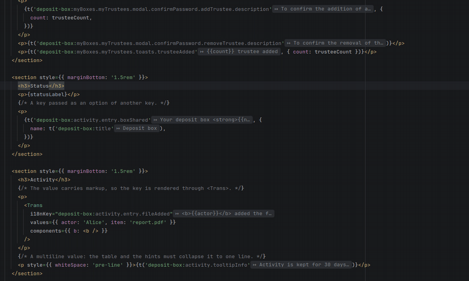

# I18n Support Plus

**Your app's translations, handled from the code that uses them**, in WebStorm, IntelliJ IDEA Ultimate and PhpStorm 2025.2 and later.

A key such as `t('checkout.pay_now')` becomes a code symbol: hover it to read its text in every language, Ctrl+click to open its translation, rename it everywhere with Shift+F6, extract a hard-coded text into a key with Alt+Enter, and fill the missing languages by machine translation or through an AI agent. The same checks run in CI with `i18n-check`.

[Install from the JetBrains Marketplace](https://plugins.jetbrains.com/plugin/30971-i18n-support-plus){ .md-button .md-button--primary } [Getting started](getting-started.md){ .md-button }

## The guides

- [Getting started](getting-started.md): from the installation to your first keys, in ten minutes
- [Frameworks, languages and file formats](frameworks.md): i18next, vue-i18n, next-intl, lingui, react-intl, Angular, Svelte, Laravel, Symfony and more
- [In the editor](editor.md): key status, navigation, completion, extraction, hints, folding, renaming, quick fixes
- [Tool window and bulk actions](tool-window.md): tree and table, reviews, stats, keys synchronizer, export and import
- [Machine translation and AI agents](translation.md): engines, glossary, tone, MCP tools
- [Checks: inspections, CI and the command line](checks.md): inspections, Qodana, `i18n-check`, GitHub Action, Docker
- [Setup and configuration](configuration.md): setup wizard, modules, every setting, `i18n-check.json`
- [Coming from i18n Ally, Easy I18n or I18n Support?](COMPARISON.md): feature-by-feature comparison and migration

Found a bug or a missing framework? [Open an issue](https://github.com/IBRAHIMDANS/i18nSupportPlus/issues/new/choose). A security problem? Read the [security policy](https://github.com/IBRAHIMDANS/i18nSupportPlus/security/policy).
