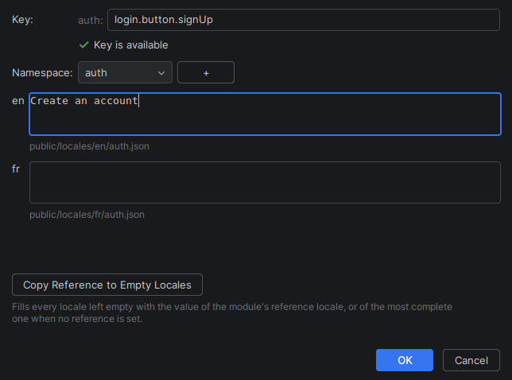
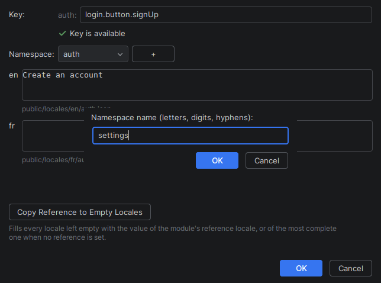
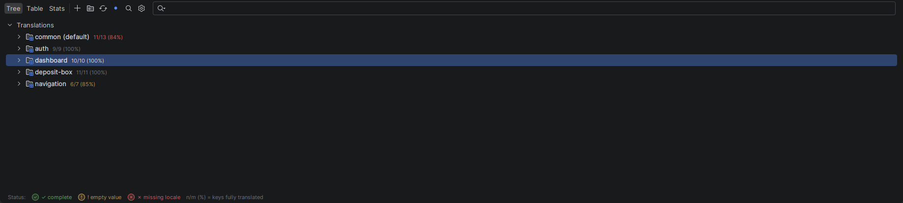
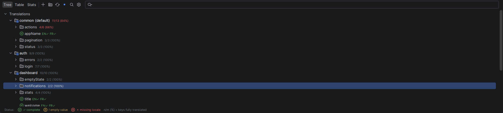
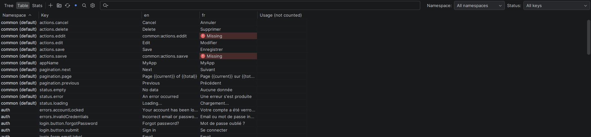
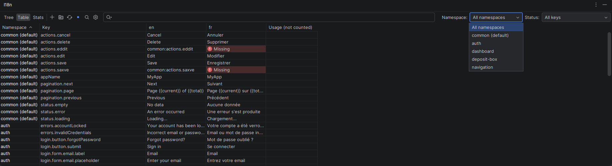
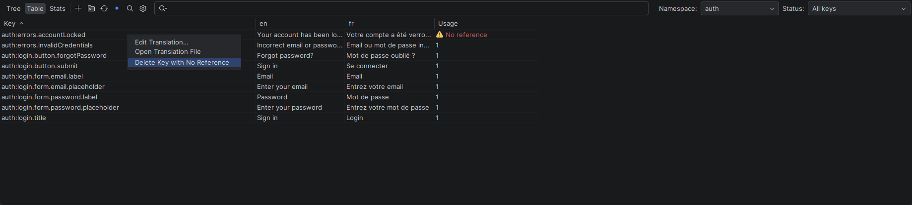
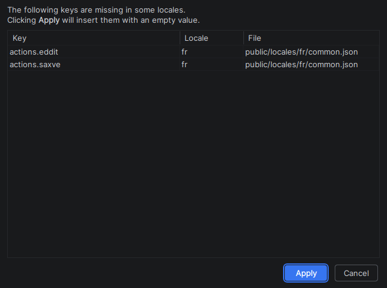
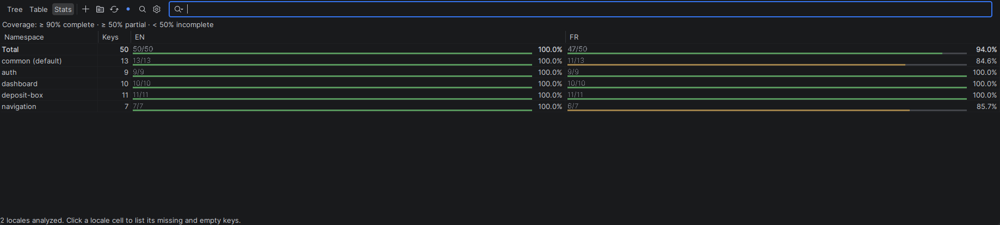
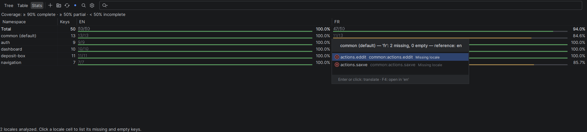

# Tool window and bulk actions

The tool window that shows every key of every locale, and the actions that work on many keys at once.

[← Back to the README](../README.md)

## Bulk Actions

The actions that work on many keys at once, from **Tools > i18n Support Plus** or the tool window's toolbar. The actions on the key under the caret — edit, extract, move, sort — are in [In the editor](editor.md#actions-on-keys).

| Action | Where | What it does |
|--------|-------|--------------|
| Sync Keys… | **Tools > i18n Support Plus**, tool window toolbar | Create in every locale the keys it lacks, with a batch dialog to fill the values |
| Count Key Usages | tool window toolbar | Count the code usages of every key and fill the table's *Usage* column |
| Clean Up Keys with No Reference… | **Tools > i18n Support Plus** | Find the keys no code refers to and delete the selected ones from every locale. A key used outside the code (API, config, database) cannot be detected: keep it in *Keys used outside the code* |
| Clean Up Reviews of Removed Values… | **Tools > i18n Support Plus** | Delete, once confirmed, the reviews whose key no longer has a value in its locale |
| Export Translations to CSV… | **Tools > i18n Support Plus** | CSV, one row per key and one column per locale (or the missing keys only), or XLIFF 1.2 for a CAT tool, one file per target locale |
| Import Translations from CSV… | **Tools > i18n Support Plus** | Write values back from a CSV or XLIFF file, with a preview of what changes before anything is written |
| Generate i18next Types | **Tools > i18n Support Plus**, i18next modules only | Write `src/@types/i18next.d.ts` from the reference locale's keys, so that `tsc` rejects an unknown key, in CI too. Meant to be committed, regenerated on demand only |
| Generate Pseudo-Locale… | **Tools > i18n Support Plus** | Write `en-XA`, an accented copy of the reference locale 30% longer, next to it: switched to it, the running application shows the text never extracted and the text that overflows |
| Show Translation Changes | **Tools > i18n Support Plus**, Commit tool window | The keys the working copy adds, removes or changes, per locale, and the locales lagging behind the reference |
| Check translations of changed keys | Commit options (the gear of the Commit tool window, or the commit dialog), off by default | Before the commit, when it changes a key of the reference locale that a locale does not follow in the same commit: says how many keys and which locales, with *Review* (the commit's translation changes) and *Commit Anyway*. Nothing is translated from there |
| Compare Translations with Branch… | **Tools > i18n Support Plus**, Commit tool window | The same against a branch (`origin/main` by default), committed changes included: the translations of a pull request. Needs the Git plugin |

## Tool Window

The **I18n** tool window (bottom panel) provides a centralized view of all translations in the project.

The toolbar picks the view — **Tree**, **Table** or **Stats** — and holds the actions — add a translation, add a namespace, refresh, Sync Keys, Count Key Usages, settings —, a **search field** filtering the tree and the table by key or value (with a result count), and, when several modules are configured, a **module selector**. In a wide window, the table's *Namespace* and *Status* filters sit next to the search field. A project in which nothing can be read shows where the plugin looked and links to the setup wizard and the settings. The window reloads itself when a translation file changes.

**Add translation** opens the same dialog as the quick fix: the key is checked as you type, one field per locale says which file it writes to, **Copy Reference to Empty Locales** fills the blanks from the reference locale, and the `+` next to the namespace creates a new one on the spot.

### Tree View

Keys grouped by **namespace**, then by segment. Every key carries its status three times over — an icon, per-locale badges (`EN✓ FR✗`) and a colour — so it survives a colour-blind reader or a custom theme; a branch shows how many of its keys are fully translated (`12/14 (86%)`), and a namespace row how complete the namespace is. A plural group (`item_one`, `item_other`) counts as one key, as in **Stats**.

- **Enter** or double-click edits the key — the dialog can also delete it from every locale —, **F4** opens the translation file at the key, typing jumps to a key
- Right-click: edit, open file, copy key
- A permanent legend sits at the bottom
- The keys of the default namespace sit in a group named after it — `common (default)` — when the configuration names a single one

### Table View

Flat table: a **Namespace** column while the rows span several namespaces, the **Key**, one column per locale, and **Usage**. Every cell says what it is — a *Missing* or *Empty* word with an icon, the value otherwise — before being tinted.

- Locale cells are **editable in place**; the value is written straight to the file, and the entry created when the locale lacks it
- Namespace filter in the dropdown; right-click the header to hide locale columns
- Status filter: keys missing or empty in a shown locale, with no reference found, or holding a value another key of the same namespace holds too
- **Count Key Usages** (toolbar) fills the Usage column, whose header says *(not counted)* until then; keys reached only through a dynamic key (`` t(`status.${kind}`) ``) are told from unused ones
- Keys used outside the code (received from an API, stored elsewhere) can be listed in the settings, *Keys used outside the code* (`errors.*`, `*.label`, `common:status.ok`): they show as *Kept* and are never offered for deletion
- Right-click: edit, open file, delete a key with no reference found

### Reviews

A module with a `.i18n-reviews/` folder keeps a review per key and locale, versioned with the code so the whole team shares it. The table then shows each cell's review (an icon and a tooltip), the status filter adds *To review*, *Stale* and *Changes requested*, and right-clicking locale cells approves them, requests changes, marks them for review or opens their thread. In a JSON or YAML translation file, the gutter shows the same icon next to each reviewed value; click it to approve the value, request changes or open its thread. A change request can carry a suggested value, applied in one click with *Apply suggestion*, and each entry of a thread can be replied to and resolved. The reviewer name is set in *Settings | Tools | i18n Support Plus | Reviews*.

- **Stale**: the value is still the one decided on, but the key's text in the module's reference locale changed since. An approval made on "Save" no longer holds once the source says "Save and close". The cell counts as *to review*, and its tooltip shows the source as it reads now: approve the value if it still fits, or translate it again (*Retranslate Stale Translations…*). The reference locale itself is never stale
- A review decided before 1.13.0 records no source: it reads as before until its next decision
- Have the whole team on 1.13.0 or later: an older version rewriting a locale's review file drops the sources recorded in it. That never turns into a false approval, but the locale stops telling stale translations until their next decision

### Keys Synchronizer

Propagates missing keys across all locales in one click. When a key exists in `en.json` but not `fr.json`, the synchronizer creates the missing entry. A **batch placeholder dialog** lets you fill in values for all missing keys at once.

### Stats

Coverage as a matrix: one row per **namespace** under a **Total** row, one column per **locale**. A cell reads `11/13 [=====    ] 84.6%` — translated keys over the namespace's keys, a bar tinted by tier (≥ 90% complete, ≥ 50% partial, below incomplete), the percentage.

Clicking a cell lists that namespace's untranslated keys in that locale — **missing** and **empty** told apart, each next to what it says in the reference locale. **Enter** or a click opens the translation dialog on the key; **F4** opens the reference file.

### Multi-Module Support

A monorepo is described as **modules** on *Settings | Tools | i18n Support Plus | Modules* — root directory, path template, key template, framework preset, see [Modules](configuration.md#modules). [examples/monorepo-react](../examples/monorepo-react/README.md) is a four-application monorepo to try it on.

- With two or more modules, the toolbar's module selector switches the three views from one module to the next.
- A code file inside a module's root directory resolves its keys against that module's translation files only. The root directory is the application's folder (`apps/shop`), not its translations folder: a module rooted at `apps/shop/public/locales` owns no code file, and the application's keys are then resolved against every module's files.
- Once modules describe the project, the files of a project attached in the same window (another content root) are not read as its translations, and *Edit Translations* opened from a code file shows its module's files and locales only. Translations the project keeps outside every module, a shared package, are still read.
- Untick a module's **Active** box to put it aside: its translation files are no longer read, the code under its root directory is neither checked nor completed, and the module selector shows it greyed — what *Excluded directories* did by hand for the applications you are not working on.
- To switch application in one click, choose a greyed module in the selector, or right-click it: **Focus on This Module** keeps it active and puts the others aside, **Activate All Modules** brings them back. Both are in *Tools › i18n Support Plus* too, and a notification offers *Undo*.
